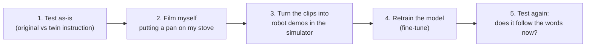

# Does the robot follow the words, or the scene?

**A one-word test for robot foundation models, and teaching the missing word with a phone.**

> 🚧 Work in progress. The numbers below are early results and will be updated.

---

## In plain words

Modern robot "brains" called **vision-language-action models (VLAs)** take a camera image and a
written instruction, and output arm motions. They score very well on the standard simulator
benchmark **LIBERO**. But in LIBERO, every scene comes with exactly one instruction, so a model can
score well **without reading the instruction at all**, just by recognising the scene and replaying
the motion it memorised for it. Like a student who aces a familiar exam by remembering where the
answers are, without reading the questions.

This project tests that with a **one-word change**, then tries to fix it using **videos I recorded
with my phone in my own kitchen**.

## The test: same kitchen, one word changed

LIBERO has a kitchen with a stove, a moka pot and a frying pan. The public model
[`smolvla_libero`](https://huggingface.co/HuggingFaceVLA/smolvla_libero) was trained in this
kitchen with only one instruction:

| | Instruction | Did the model train on it? |
|---|---|---|
| **Original** | "turn on the stove and put the **moka pot** on it" | ✅ yes |
| **Twin** | "turn on the stove and put the **frying pan** on it" | ❌ never |

Both tasks use the **exact same scene and starting positions**. Only the goal changes. So:

- if the robot **reads** the instruction, it should pick up the **frying pan**;
- if it **replays its memory** of this kitchen, it goes for the **moka pot**.

## Plan



1. **Test the model as-is** on both instructions and record what it actually does: does it turn
   on the stove, and which object does it pick up?
2. **Film myself** moving a real pan onto a real stove (~15-20 short clips, printed markers on
   the counter and in the pan).
3. **Convert the clips into robot demonstrations** inside the simulator (see
   [How a phone clip becomes a robot demo](docs/how-it-works.md)).
4. **Fine-tune** (briefly retrain) the model on those demos.
5. **Test again**, and compare with the same model fine-tuned on 50 demos that a human recorded
   by remote-controlling the simulated robot (LIBERO ships these for the twin task).

## Results so far

| Test | Tries | Success | What happened |
|---|---|---|---|
| Easy sanity task (soup can into basket) | 10 | 7/10 | the setup works |
| **Original**: "…put the moka pot on it" | 3 | 2/3 | does the task it was trained on |
| **Twin**: "…put the frying pan on it" | 10 | **0/10** | never picked up the pan; sometimes went for the moka pot; often missed the stove knob |

**Early takeaway:** change one word and the model does not follow it.

**Can the robot physically do the twin task?** Yes: a hand-coded version of the motion pieces
(turn the knob, grasp the pan handle, carry, place) succeeds in 10/10 official start layouts and
10/10 more checked independently. These are the pieces that turn a phone clip into robot demos.

## Run it yourself

Linux only (LIBERO requirement). Tested on Ubuntu 24.04, Python 3.12, NVIDIA GPU.

```bash
python3 -m venv .venv && source .venv/bin/activate
pip install "lerobot[libero]"
python -c "import libero.libero"        # first run asks for a dataset path: answer n
```

See the two kitchen tasks and a human demo:

```bash
MUJOCO_GL=egl python scripts/check_kitchen_render.py   # saves pictures of both tasks
MUJOCO_GL=egl python scripts/replay_demo.py --demo 0   # replays a recorded human demo as a video
```

Test the model on the twin instruction, with a log of what the robot did in every try:

```bash
MUJOCO_GL=egl python scripts/eval_with_log.py \
  --policy.path=HuggingFaceVLA/smolvla_libero \
  --policy.n_action_steps=10 --policy.num_steps=10 \
  --env.type=libero --env.task=libero_90 --env.task_ids='[21]' \
  --eval.n_episodes=10 --eval.batch_size=1 \
  --output_dir=./eval_logs/pan_10ep
```

Use `--env.task=libero_10 --env.task_ids='[2]'` for the original moka-pot instruction.

Good to know:
- Keep `--policy.n_action_steps=10 --policy.num_steps=10`: the model re-plans every 10 steps.
  With the default (50), it scored 0 even on the task it was trained on.
- A try lasts at most 400 steps (twin) or 520 steps (original), at 20 steps per second of
  simulated time.
- Saved videos play 4x faster than real time; watch with `mpv --speed=0.25 <file>`.

## What's in this repository

| Path | What it is |
|---|---|
| `scripts/check_kitchen_render.py` | Pictures of the two kitchen tasks |
| `scripts/replay_demo.py` | Replays a recorded human demo of the twin task as a video |
| `scripts/eval_with_log.py` | Runs the standard LeRobot test and logs what the robot did in each try |
| `scripts/watch_eval.py` | Same test, with a live camera window |
| `scripts/render_scenes.py`, `render_all_parallel.py`, `make_sheets.py` | Pictures of all 130 LIBERO tasks |
| `scripts/make_markers.py`, `assets/markers_letter.pdf` | Printable markers for filming |
| `scripts/check_markers.py` | Checks a test clip from the filming setup: are the board and the pan marker found? |
| `scripts/calibrate_camera.py`, `data/calibration/ipad_1080p.json` | Camera calibration from clips of the board, and the result for the iPad used |
| `scripts/track_pan.py` | Tracks the pan in a clip: its 3-D path relative to the board, phases, quality numbers (`path.json`) |
| `scripts/render_tracking.py` | Draws the tracked path back onto the clip to check the tracking by eye |
| `scripts/summarize_tracks.py` | One figure and a quality table for all tracked takes |
| `sim/kitchen_controller.py` | Motion pieces in the simulator: knob turn, pan grasp, carry along a given path, place |
| `sim/run_controller_eval.py` | Runs those pieces on LIBERO's start layouts and reports success |
| `docs/how-it-works.md` | How phone clips become robot demos, with references |
| `docs/filming.md` | How the phone clips are recorded |

## Glossary

- **VLA (vision-language-action model):** a neural network that maps camera images + an
  instruction to robot motions.
- **LIBERO:** a robot simulator with 130 standard tasks, used to compare VLAs.
- **Demo (demonstration):** a recording of a task being done: what the cameras saw and the arm
  command at every step. Models learn by imitating demos.
- **Zero-shot:** testing a model on something it was never trained on, without retraining it.
- **Fine-tuning:** continuing to train an already-trained model on a small amount of new data.

## Related work

See [docs/how-it-works.md](docs/how-it-works.md#references) for the full list.
