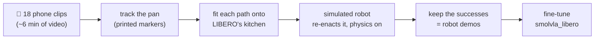
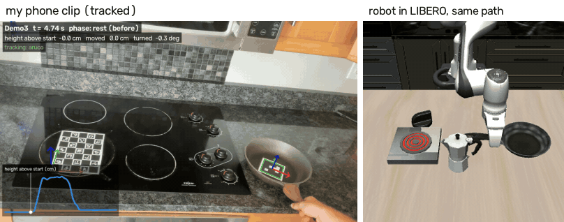
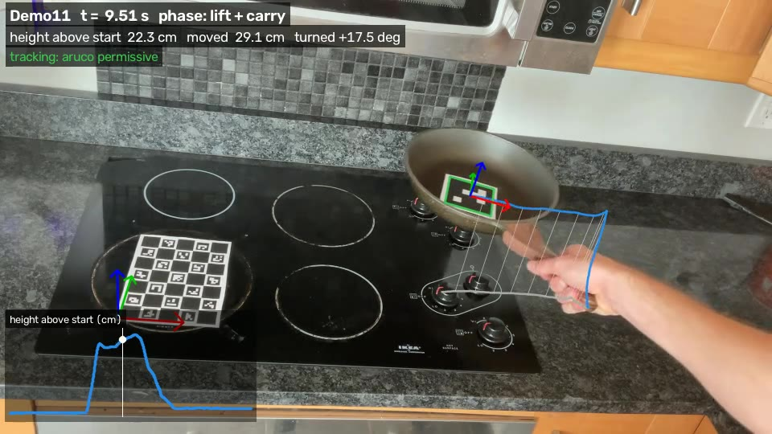
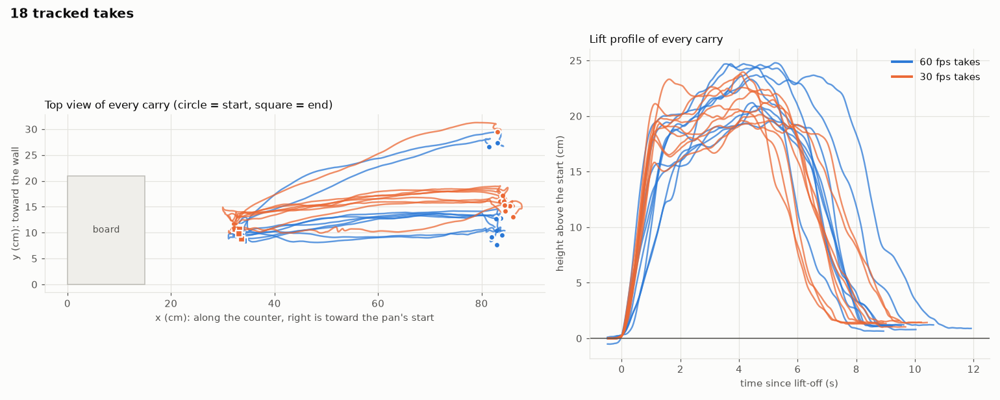

# Does the robot follow the words, or the scene?

**A one-word test for a robot foundation model, and teaching it the missing word with 18 short
phone clips (about 6 minutes of video).**

## In short

- **Finding:** the public model `smolvla_libero` does LIBERO's "turn on the stove and put the
  **moka pot** on it" (2/3 tries), but change one word to "**frying pan**" (same kitchen, a LIBERO
  task it never trained on) and it succeeds **0/10** times and never picks up the pan. It follows
  the scene, not the words.
- **Idea:** teach the missing word with phone videos of me moving a real pan in my kitchen.
  Printed markers give the pan's 3-D path; a simulated robot re-enacts each path in LIBERO's
  kitchen, with physics, over many new arrangements of the objects; the successes become
  **153 robot demonstrations**.
- **Comparison:** fine-tune on LIBERO's 50 human-teleoperated demos (**T**), on 50 phone-derived
  demos (**P**), or on all of them (**Pall**), and test every model on both instructions in
  LIBERO's 50 test layouts.
- **Status:** clips recorded, tracked and turned into robot demos; fine-tuning and evaluation are
  next, and the results will be filled in below.

---

## In plain words

Robot "brains" called **vision-language-action models (VLAs)** take a camera image and a written
instruction, and output arm motions. They score very well on the standard simulator benchmark
**LIBERO**. But in most LIBERO tasks the scene alone gives the task away (each arrangement of
objects comes with a single instruction; LIBERO-Goal is the exception), so a model can score well
there **without reading the instruction at all**, just by recognising the scene and replaying the
motion it memorised for it, like a student who passes a familiar exam by remembering where the
answers are, without reading the questions.

This project:
1. **tests** that with a **one-word change** to a LIBERO instruction, and
2. **tries to fix it with phone videos of me** doing the task in my own kitchen, turned into robot
   training data in the simulator, and compares that with the usual (expensive) way of collecting
   robot data.

## 1. The test: same kitchen, one word changed

LIBERO has a kitchen with a stove, a moka pot and a frying pan. The public model
[`smolvla_libero`](https://huggingface.co/HuggingFaceVLA/smolvla_libero) was trained on this
kitchen with only one instruction:

| | Instruction | In the model's training data? |
|---|---|---|
| **Original** (LIBERO-10, task 2) | "turn on the stove and put the **moka pot** on it" | ✅ yes |
| **Twin** (LIBERO-90, task 21) | "turn on the stove and put the **frying pan** on it" | ❌ never |

Both tasks use the **same scene, the same objects and the same placement regions** (their task
files differ only in the goal; their fixed start layouts differ by a few cm). If the model
**reads** the instruction it should pick up the frying pan; if it **replays its memory** of this
kitchen it goes for the moka pot.

**Result (unchanged model):**

| Instruction | Tries | Success | What happened |
|---|---|---|---|
| Sanity check, an easy LIBERO task (soup can into basket) | 10 | 7/10 | the setup works |
| **Original**: "…put the moka pot on it" | 3 | 2/3 | does the task it was trained on |
| **Twin**: "…put the frying pan on it" | 10 | **0/10** | never picked up the pan; sometimes went for the moka pot; often missed the stove knob |

**Change one word and the model stops working.** The twin task is officially part of LIBERO (it
even ships 50 demonstrations for it); the model just never trained on it. These are small numbers
(3 and 10 tries); the final evaluation repeats both instructions on all 50 test layouts. LIBERO
gives the twin task 400 control steps (20 s) and the moka-pot task 520.

## 2. The idea: teach the missing word with a phone

The usual way to teach a robot a new task is **teleoperation**: a person drives the robot
(real or simulated) through every demonstration with a joystick-like controller. That is slow
and needs equipment. Instead, I filmed myself putting a real pan on my real stove and turned the
videos into robot demonstrations in the simulator:



The key idea is **object-centric**: a human hand and a robot gripper move very differently, but
*"the pan rose 22 cm, travelled 51 cm left, turned 24° and landed on the burner"* means the same
thing for both. So the video is used only for **what happened to the pan**; the simulator supplies
everything robot-specific (how to grasp, the arm commands, the camera images the model learns
from).



*Left: one of my takes with the tracking drawn on it. Right: the simulated robot carrying the pan
along the same path in a new arrangement of the kitchen, seen by the two cameras the model learns
from ([still version](docs/img/real_vs_sim.jpg)).*

### Filming and tracking

A printed marker inside the pan and a printed checkerboard on the stove let the camera measure the
pan's 3-D position and rotation in every frame (jitter under 1 mm while it rests; an independent
re-implementation of the tracker agreed to 0.4 cm on a test clip). How the clips were filmed:
[docs/filming.md](docs/filming.md).



All 18 takes, tracked:



| | 18 takes |
|---|---|
| video | 18-22 s per take, 357 s in total (9 takes at 60 fps, 9 at 30 fps) |
| frames where the pan was measured | 95-100 % (17 takes at 99-100 %) |
| carry distance | 48-53 cm (median 51.5 cm) |
| lift height | 20-25 cm (median 21.7 cm) |
| carry time | 7.3-10.9 s (median 8.4 s) |
| turn during the carry | median +24° (-53° to +30°) |
| jitter while the pan sits still | 0.35-0.83 mm |

### From a phone path to a robot demonstration

For every take and every new arrangement of the kitchen objects:

1. **Fit the path onto LIBERO's kitchen.** It is rotated, scaled (by about 0.8: my ~51 cm become
   the simulator's ~41 cm) and shifted so that my start spot lands on the simulated pan and my
   burner on the simulated burner. The lift curve, the small sideways curve, the turn and the
   timing are kept, with two changes: the carry is played 1.5x faster (so the whole task fits the
   20 s limit; the pan's speed is also capped at 0.25 m/s), and where the pan would pass within
   2 cm of the simulated moka pot (my counter has none), that stretch of the path is raised (by
   about 9 cm, in 1 demo in 5).
2. **The simulated robot turns the stove knob and grasps the pan's handle.** Both are scripted: the
   knob turn is the same as in the moka-pot task; the grasp is a top-down grasp of the handle,
   chosen to keep the wide gripper clear of the moka pot.
3. **It carries the pan along my path.** 20 times a second the controller compares where the
   *simulated* pan is with where my path says it should be 0.2 s later, and sends the arm the 7
   numbers (hand move x/y/z, hand turn x/y/z, gripper) that close the gap. The physics engine
   moves the arm and the pan; the simulated pan typically stays within **half a centimetre** of
   the fitted path (median 0.43 cm RMS; median 1.6 cm where the path had to be raised; demos
   above 2 cm are discarded).
4. **It places and releases the pan, and LIBERO's own success check decides.** Only successes are
   kept, recorded exactly as the model sees and acts: both camera images, the robot state, the
   7-number actions, and the instruction.

Repeating this over new random arrangements of the objects (the idea behind MimicGen) turned
17 of the 18 takes into **153 robot demos**, 9 per take (222 arrangements tried; details below).
Method, design choices and references: [**How a phone clip becomes a robot demo**](docs/how-it-works.md).

## 3. The comparison

Three fine-tunes of `smolvla_libero`, identical except for where the frying-pan demos come from.
Each also gets LIBERO's moka-pot demos: since both tasks share the scene, the instruction is the
only way to tell them apart.

| Run | Frying-pan demos | Question it answers |
|---|---|---|
| **T** | LIBERO's 50 human **teleoperation** demos | the standard, expensive way (baseline) |
| **P** | **50** phone-derived demos (spread evenly over the takes) | are phone demos as good as teleop demos at the same count? |
| **Pall** | **all 153** phone-derived demos | what does multiplying 6 minutes of video buy? |

All runs use the same training steps and settings; Pall therefore sees each of its demos less
often than P does.

Every model, and the unchanged one, is then tested on **both instructions** in LIBERO's 50 fixed
test layouts, recording success and which object it picked up first:
- *frying pan*: did it learn to follow the new word?
- *moka pot*: did it keep the old skill, and still tell the two apart?

The phone demos never start from the 50 test layouts, but LIBERO's placement regions are small, so
the nearest test layout is only 0.3-2.5 cm away (median 1.2 cm, pan + moka pot positions). Whether
LIBERO's own teleop demos start from the test layouts is reported when run T's data is built
([docs/training.md](docs/training.md)).

## 4. Results

*Coming after training.* The table will compare the unchanged model, T, P and Pall on both
instructions: success rate and which object each picked up first.

## What worked, and what didn't (so far)

- ✅ **Tracking the object, not the hand.** Printed markers gave a clean 3-D path for every take.
  The pan's rim partly hid the marker (the camera ended up looking down only 34°); matching a
  template of the whole marker fixed that. False detections while the pan was tilted steeply
  toward the camera were caught by outlier checks (frames rejected in 3 takes).
- ✅ **Physics-checked demos.** Every robot demo was actually executed and passed LIBERO's own
  success check. Spot checks (6 demos) rebuild pixel-identically in LeRobot's evaluation
  environment and replay to success at the same step (one a step later).
- ⚠️ **One near-miss bug:** the demo generator first set the simulated robot up slightly differently
  from LeRobot's evaluation environment (robot start noise). Caught by that exact-replay check
  before any data was used.
- ⚠️ **About 1 in 5 random arrangements gives no usable demo** (42 of 195 for the 17 usable takes:
  20 strayed more than 2 cm from the path, 17 failed the task, 5 nudged the moka pot), mostly
  when the moka pot sits right next to the pan's handle: the robot then grasps at an angle and
  the pan turns in the gripper. They are replaced by new arrangements, so tight layouts are
  under-represented.
- ⚠️ **One take gave no demos.** In Demo9 I turned the pan 53° during the carry. In all 27
  arrangements tried, the simulated pan strayed 3-4 cm from that path, knocked the moka pot or
  failed, so 17 of the 18 takes contribute.
- ⚠️ **The pan turns in the robot's grasp** (median 12°, more than 20° in a third of the demos, up to
  35°). The controller
  steers on the pan itself, so the pan still follows the path, but the arm then moves differently
  from a clean carry.
- ℹ️ **Scripted parts:** the knob turn and the grasp are not learned from video, so *which object*
  is picked up (the pan, by its handle) is fixed by the script for this task. The video supplies
  the carry: where the pan goes, along which path, how high and how fast.
- ℹ️ **What P vs T can and cannot show:** the phone demos' arm motions come from a scripted
  controller, T's from human teleoperators. A difference between them may come from scripted vs
  human motion as much as from the video. A control run with the scripted carry alone (no video
  path) would separate the two; it is not one of the three runs.

## Run it yourself

Linux (LIBERO requirement). Evaluation and training: LeRobot 0.6.x on Ubuntu 24.04, Python 3.12,
NVIDIA GPU. Tracking and demo generation ran on CPU in a Python 3.11 environment with hf-libero
0.1.4, robosuite 1.4.0, MuJoCo 3.8.1 and OpenCV 5.0 (`MUJOCO_GL=osmesa`); `lerobot[libero]`
installs the same simulator versions.

```bash
python3 -m venv .venv && source .venv/bin/activate
pip install "lerobot[libero,smolvla]"
python -c "import libero.libero"        # first run asks for a dataset path: answer n
```

**The zero-shot test**, with a log of what the robot did in every try:

```bash
MUJOCO_GL=egl python scripts/eval_with_log.py \
  --policy.path=HuggingFaceVLA/smolvla_libero \
  --policy.n_action_steps=10 --policy.num_steps=10 \
  --env.type=libero --env.task=libero_90 --env.task_ids='[21]' \
  --eval.n_episodes=10 --eval.batch_size=1 --output_dir=./eval_logs/pan_10ep
```

Use `--env.task=libero_10 --env.task_ids='[2]'` for the original moka-pot instruction. Keep
`--policy.n_action_steps=10 --policy.num_steps=10`: with the default `n_action_steps=50` (run the
whole 50-step action chunk before looking again) the model scored 0 even on the task it was
trained on. Saved videos play 4x faster than real time (`mpv --speed=0.25`).

**From phone clips to robot demos.** The clips are not in this repository (`*.mov` is
git-ignored; they are kept in a separate private repository, with their location metadata
stripped). With your own clips:

```bash
# 1. camera calibration (clips of the printed board moved in front of the fixed phone)
python scripts/calibrate_camera.py calib_*.mov --out data/calibration/ipad_1080p.json
# 2. track the pan in each take, draw the tracking on the video, summarise all takes
python scripts/track_pan.py Demo1.mov --calib data/calibration/ipad_1080p.json --out tracks/Demo1
python scripts/render_tracking.py Demo1.mov tracks/Demo1/path.json --out tracks/Demo1/tracking.mp4
python scripts/summarize_tracks.py tracks --out tracks/summary
# 3. robot demos: every tracked take x new arrangements, physics-checked
#    (3 rounds x 3 kept arrangements per take; seeds 0/100/200 give different arrangements)
for r in 0 1 2; do
  MUJOCO_GL=egl python sim/make_demos.py tracks --layouts 3 --seed $((100*r)) --speedup 1.5 \
    --max-steps 400 --workers 3 --out demos/r$r
done
python sim/summarize_demos.py demos/r0 demos/r1 demos/r2
# 4. LeRobot datasets: 50 demos spread over the takes (run P), and all of them (run Pall)
python train/convert_phone_npz.py demos/r0 demos/r1 demos/r2 --fps 10 --max-episodes 50 --out datasets/phone_pan_P
python train/convert_phone_npz.py demos/r0 demos/r1 demos/r2 --fps 10 --out datasets/phone_pan_all
```

**Fine-tuning and evaluation:** [docs/training.md](docs/training.md).

## What's in this repository

| Path | What it is |
|---|---|
| `docs/how-it-works.md` | How phone clips become robot demos: method, design choices, references |
| `docs/filming.md`, `docs/img/filming_layout.png` | Filming instructions, written before the shoot, with a note on how the takes were actually recorded |
| `docs/training.md` | Building the datasets, fine-tuning, evaluating |
| `scripts/make_markers.py`, `assets/markers_letter.pdf` | Printable markers |
| `scripts/check_markers.py` | Checks a test clip: are the board and the pan marker found? |
| `scripts/calibrate_camera.py`, `data/calibration/ipad_1080p.json` | Camera calibration, and the result for the iPad used |
| `scripts/track_pan.py` | Tracks the pan: its 3-D path relative to the board, phases, quality numbers |
| `scripts/render_tracking.py`, `scripts/summarize_tracks.py` | Tracking drawn on the video; one figure and table for all takes |
| `sim/kitchen_controller.py` | The robot's scripted pieces in LIBERO: knob turn, handle grasp, carry, place |
| `sim/real_path.py` | Fits a tracked path onto LIBERO's kitchen and has the robot follow it |
| `sim/make_demos.py`, `sim/summarize_demos.py` | Tracked paths x new arrangements -> physics-checked robot demos; their statistics |
| `sim/check_demo_conventions.py` | Rebuilds a demo in LeRobot's evaluation environment and replays it |
| `sim/write_lerobot_dataset.py` | A second LeRobot dataset writer for the demos, with a reload check |
| `sim/run_controller_eval.py` | Success rate of the scripted controller alone on the twin task (development check) |
| `scripts/compare_demos.py` | LIBERO's teleop demos vs the phone-derived demos: side-by-side video, gripper-path figure, table |
| `train/` | Dataset building (moka subset, teleop demos, phone demos, merges), training and evaluation scripts |
| `scripts/eval_with_log.py`, `scripts/watch_eval.py` | LeRobot evaluation with a per-try behaviour log / a live window |
| `scripts/check_kitchen_render.py`, `scripts/replay_demo.py` | Pictures of the two kitchen tasks; replay of a LIBERO teleop demo |
| `scripts/render_scenes.py`, `scripts/render_all_parallel.py`, `scripts/make_sheets.py` | Pictures of all 130 LIBERO tasks |

## Glossary

- **VLA (vision-language-action model):** a neural network that maps camera images and an
  instruction to robot motions.
- **LIBERO:** a robot simulator with 130 standard tasks, used to compare VLAs. Its tasks are
  grouped in suites; `smolvla_libero` was trained on four of them (LIBERO-Spatial, -Object, -Goal
  and LIBERO-10) but not on LIBERO-90, where the frying-pan twin lives.
- **Demo (demonstration):** a recording of a task being done: what the cameras saw and the arm
  command at every step. Models learn by imitating demos.
- **Teleoperation:** a person drives the robot live to record demos.
- **Zero-shot:** testing a model on something it was never trained on, without retraining it.
- **Fine-tuning:** continuing to train an already-trained model on a small amount of new data.
- **Object-centric:** describing a demonstration by what happened to the object, not by the hand.
- **Layout / arrangement:** where the pan, the moka pot and the stove stand at the start of a try.

## Related work

**What is new here, as far as I know:** (1) a same-scene, one-word twin test in the LIBERO-10
kitchen (LangGap and others test instruction changes in other LIBERO suites); (2) object-centric
phone video turned into physics-checked demos *inside an existing benchmark scene*, so phone data
can be compared head-to-head with the benchmark's own teleoperated demos on its own test.

LIBERO; SmolVLA and LeRobot; LIBERO-PRO, LIBERO-Plus and LangGap (VLAs that don't follow the
instruction); MimicGen, DemoGen, Real2Render2Real, X-Sim (turning a few demos or human videos into
robot data). Full list with links: [docs/how-it-works.md](docs/how-it-works.md#references).
