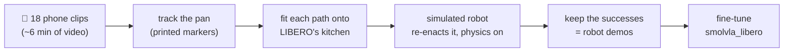

# Does the robot follow the words, or the scene?

**A one-word test for a robot foundation model, and teaching it the missing word with 18 short
phone clips (about 6 minutes of video).**


*Left: the public model, told to put the **frying pan** on the stove, puts the **moka pot** there:
the task it was trained on in this kitchen. Middle and right: after fine-tuning with demos made
from my phone videos (run Pall), the same kind of model puts on the stove whichever object it is
told. Three of LIBERO's test layouts, real time.*

## In short

- **Finding:** the public model `smolvla_libero` does LIBERO's "turn on the stove and put the
  **moka pot** on it" (26/50 test layouts), but change one word to "**frying pan**" (same
  kitchen, a LIBERO task it never trained on) and it succeeds **0/50** times: it never picks up
  the pan, and when it lifts anything, it is the moka pot. It follows the scene, not the words.
- **Idea:** teach the missing word with phone videos of me moving a real pan in my kitchen.
  Printed markers give the pan's 3-D path; a simulated robot re-enacts each path in LIBERO's
  kitchen, with physics, over many new arrangements of the objects; the successes become
  **153 robot demonstrations**.
- **Comparison:** fine-tune on LIBERO's 50 human-teleoperated demos (**T**), on 50 phone-derived
  demos (**P**), or on all of them (**Pall**), and test every model on both instructions in
  LIBERO's 50 test layouts.
- **Result:** every fine-tune now follows the word, in both directions, and keeps the original
  task. Phone demos take the frying pan from **0 to 62%** (Pall) against **90%** with LIBERO's
  human demos. Where the moka pot does not start close to the pan, the phone-trained model is as
  good as the human-trained one (23/25 vs 24/25); it loses in the tight layouts, which the phone
  demos under-represent ([section 4](#4-results)).

| Success in LIBERO's 50 test layouts | "…put the **frying pan** on it" | "…put the **moka pot** on it" |
|---|---|---|
| unchanged `smolvla_libero` | **0/50** | 26/50 |
| **T**: + 50 human teleoperation demos | **45/50** | 35/50 |
| **P**: + 50 phone-derived demos | **18/50** | 32/50 |
| **Pall**: + 153 phone-derived demos | **31/50** | 34/50 |

---

## In plain words

Robot "brains" called **vision-language-action models (VLAs)** take a camera image and a written
instruction, and output arm motions. They score very well on the standard simulator benchmark
**LIBERO**. But in most LIBERO tasks the scene alone gives the task away (each arrangement of
objects comes with a single instruction; LIBERO-Goal is the exception), so a model can score well
there **without reading the instruction at all**, just by recognising the scene and replaying the
motion it memorised for it, like a student who passes a familiar exam by remembering where the
answers are, without reading the questions.

This project:
1. **tests** that with a **one-word change** to a LIBERO instruction, and
2. **tries to fix it with phone videos of me** doing the task in my own kitchen, turned into robot
   training data in the simulator, and compares that with the usual (expensive) way of collecting
   robot data.

## 1. The test: same kitchen, one word changed

LIBERO has a kitchen with a stove, a moka pot and a frying pan. The public model
[`smolvla_libero`](https://huggingface.co/HuggingFaceVLA/smolvla_libero) was trained on this
kitchen with only one instruction:

| | Instruction | In the model's training data? |
|---|---|---|
| **Original** (LIBERO-10, task 2) | "turn on the stove and put the **moka pot** on it" | ✅ yes |
| **Twin** (LIBERO-90, task 21) | "turn on the stove and put the **frying pan** on it" | ❌ never |

Both tasks use the **same scene, the same objects and the same placement regions** (their task
files differ only in the goal; their fixed start layouts differ by a few cm). If the model
**reads** the instruction it should pick up the frying pan; if it **replays its memory** of this
kitchen it goes for the moka pot.

**First look (unchanged model, a few tries):**

| Instruction | Tries | Success | What happened |
|---|---|---|---|
| Sanity check, an easy LIBERO task (soup can into basket) | 10 | 7/10 | the setup works |
| **Original**: "…put the moka pot on it" | 3 | 2/3 | does the task it was trained on |
| **Twin**: "…put the frying pan on it" | 10 | **0/10** | never picked up the pan; sometimes went for the moka pot; often missed the stove knob |

**Change one word and the model stops working.** The twin task is officially part of LIBERO (it
even ships 50 demonstrations for it); the model just never trained on it. The full evaluation on
all 50 test layouts ([section 4](#4-results)) confirms it: 0/50 on the frying pan, 26/50 on the
moka pot. LIBERO gives the twin task 400 control steps (20 s) and the moka-pot task 520.

## 2. The idea: teach the missing word with a phone

The usual way to teach a robot a new task is **teleoperation**: a person drives the robot
(real or simulated) through every demonstration with a joystick-like controller. That is slow
and needs equipment. Instead, I filmed myself putting a real pan on my real stove and turned the
videos into robot demonstrations in the simulator:



The key idea is **object-centric**: a human hand and a robot gripper move very differently, but
*"the pan rose 22 cm, travelled 51 cm left, turned 24° and landed on the burner"* means the same
thing for both. So the video is used only for **what happened to the pan**; the simulator supplies
everything robot-specific (how to grasp, the arm commands, the camera images the model learns
from).


*Left: one of my takes with the tracking drawn on it. Right: the simulated robot carrying the pan
along the same path in a new arrangement of the kitchen, seen by the two cameras the model learns
from ([still version](docs/img/real_vs_sim.jpg)).*

### Filming and tracking

A printed marker inside the pan and a printed checkerboard on the stove let the camera measure the
pan's 3-D position and rotation in every frame (jitter under 1 mm while it rests; an independent
re-implementation of the tracker agreed to 0.4 cm on a test clip). How the clips were filmed:
[docs/filming.md](docs/filming.md).


All 18 takes, tracked:


| | 18 takes |
|---|---|
| video | 18-22 s per take, 357 s in total (9 takes at 60 fps, 9 at 30 fps) |
| frames where the pan was measured | 95-100 % (17 takes at 99-100 %) |
| carry distance | 48-53 cm (median 51.5 cm) |
| lift height | 20-25 cm (median 21.7 cm) |
| carry time | 7.3-10.9 s (median 8.4 s) |
| turn during the carry | median +24° (-53° to +30°) |
| jitter while the pan sits still | 0.35-0.83 mm |

### From a phone path to a robot demonstration

For every take and every new arrangement of the kitchen objects:

1. **Fit the path onto LIBERO's kitchen.** It is rotated, scaled (by about 0.8: my ~51 cm become
   the simulator's ~41 cm) and shifted so that my start spot lands on the simulated pan and my
   burner on the simulated burner. The lift curve, the small sideways curve, the turn and the
   timing are kept, with two changes: the carry is played 1.5x faster (so the whole task fits the
   20 s limit; the pan's speed is also capped at 0.25 m/s), and where the pan would pass within
   2 cm of the simulated moka pot (my counter has none), that stretch of the path is raised (by
   about 9 cm, in 1 demo in 5).
2. **The simulated robot turns the stove knob and grasps the pan's handle.** Both are scripted: the
   knob turn is the same as in the moka-pot task; the grasp is a top-down grasp of the handle,
   chosen to keep the wide gripper clear of the moka pot.
3. **It carries the pan along my path.** 20 times a second the controller compares where the
   *simulated* pan is with where my path says it should be 0.2 s later, and sends the arm the 7
   numbers (hand move x/y/z, hand turn x/y/z, gripper) that close the gap. The physics engine
   moves the arm and the pan; the simulated pan typically stays within **half a centimetre** of
   the fitted path (median 0.43 cm RMS; median 1.6 cm where the path had to be raised; demos
   above 2 cm are discarded).
4. **It places and releases the pan, and LIBERO's own success check decides.** Only successes are
   kept, recorded exactly as the model sees and acts: both camera images, the robot state, the
   7-number actions, and the instruction.

Repeating this over new random arrangements of the objects (the idea behind MimicGen) turned
17 of the 18 takes into **153 robot demos**, 9 per take (222 arrangements tried; details below).
They are public on Hugging Face in LeRobot format:
[`Delcastillo8/libero90_frying_pan_phone`](https://huggingface.co/datasets/Delcastillo8/libero90_frying_pan_phone)
(all 153) and [`Delcastillo8/libero90_frying_pan_phone_50`](https://huggingface.co/datasets/Delcastillo8/libero90_frying_pan_phone_50)
(the 50 of run P); the "Visualize this dataset" button on each page plays every episode.
Method, design choices and references: [**How a phone clip becomes a robot demo**](docs/how-it-works.md).

## 3. The comparison

Three fine-tunes of `smolvla_libero`, identical except for where the frying-pan demos come from.
Each also gets LIBERO's moka-pot demos: since both tasks share the scene, the instruction is the
only way to tell them apart.

| Run | Frying-pan demos | Question it answers |
|---|---|---|
| **T** | LIBERO's 50 human **teleoperation** demos | the standard, expensive way (baseline) |
| **P** | **50** phone-derived demos (spread evenly over the takes) | are phone demos as good as teleop demos at the same count? |
| **Pall** | **all 153** phone-derived demos | what does multiplying 6 minutes of video buy? |

All runs use the same training steps and settings (20 000 steps, batch 32). Pall therefore sees
each of its demos less often than P does (about 12 passes over its data instead of 26), and its 41
moka-pot demos are a smaller share of its training episodes (21 % instead of 45 %).

Every model, and the unchanged one, is then tested on **both instructions** in LIBERO's 50 fixed
test layouts, recording success and which object it picked up first:
- *frying pan*: did it learn to follow the new word?
- *moka pot*: did it keep the old skill, and still tell the two apart?

Neither training set starts from the 50 test layouts, but all three draw from the same small
start areas: LIBERO lets the pan and the moka pot start anywhere inside a 5 x 5 cm square each,
and every phone demo uses a new random draw from them, as LIBERO's own human demos and test
layouts do. The nearest test layout is 0.3-2.5 cm away for the phone demos (median 1.2 cm, pan +
moka pot positions) and 0.5-2.1 cm for LIBERO's teleop demos: the same situation for both.


Spreading the pan wider, as MimicGen does for robustness, was a deliberate no: the test only
uses these areas, and LIBERO's human demos come from them too, so wider layouts would change what
P is compared with and would not show in the results. Robustness to new placements is a natural
next step with its own wider test layouts.

### What the two kinds of frying-pan demos look like


*Left: one of LIBERO's 50 teleop demos, a person steering the robot with a 3-D mouse. Right: one
phone-derived demo (knob turn and grasp scripted; the carry follows my pan's path from a phone
clip). Same task and simulator, the two cameras the model learns from (mirrored left-right, as
LIBERO stores them). The bar under each side shows when the gripper is closed.*

Over all 50 demos of each ([gripper paths of every demo](docs/img/teleop_vs_phone_paths.png),
[full table](docs/img/teleop_vs_phone.md)):

| median | LIBERO teleop (run T) | phone-derived (run P) |
|---|---|---|
| demo length | 13.7 s | 13.8 s |
| time with the pan in hand | 3.8 s | 6.8 s |
| pan moved, grasp to release | 44 cm | 40 cm |
| pan lifted above the grasp | 21 cm | 24 cm |
| fastest 5 % of steps | 25 cm/s | 41 cm/s |
| gripper closed | 45 % of steps | 84 % of steps |

Same length, height and distance, but a different rhythm: the people take longer to turn the knob
and reach the handle (grasp at 9.2 s vs 6.9 s) and then carry the pan faster; the scripted robot
reaches at full speed, pushes the knob with closed fingers (hence 84 %) and carries the pan at the
pace of my video (sped up 1.5x).

## 4. Results

Every model was tested on both instructions in the same 50 LIBERO test layouts, one try per
layout. Per-try logs: [`results/`](results/); the summary with every pairwise test:
[`results/summary.md`](results/summary.md); every other number in this section:
`python scripts/analyze_results.py`.

| Successes out of 50 (95 % interval) | "…put the **frying pan** on it" (new) | "…put the **moka pot** on it" (original) |
|---|---|---|
| unchanged `smolvla_libero` | **0/50** (0-7 %) | 26/50 (39-65 %) |
| **T**: + 50 human teleoperation demos | **45/50** (79-96 %) | 35/50 (56-81 %) |
| **P**: + 50 phone-derived demos | **18/50** (24-50 %) | 32/50 (50-76 %) |
| **Pall**: + 153 phone-derived demos | **31/50** (48-74 %) | 34/50 (54-79 %) |

| First object lifted (> 3 cm) | told "frying pan": pan / moka pot / nothing | told "moka pot": moka pot / pan / nothing |
|---|---|---|
| unchanged | 0 / 12 / 38 | 28 / 0 / 22 |
| T | 46 / 0 / 4 | 35 / 0 / 15 |
| P | 23 / 0 / 27 | 32 / 0 / 18 |
| Pall | 32 / 1 / 17 | 36 / 0 / 14 |

**1. The unchanged model follows the scene.** Told "frying pan", it never lifts the pan; when it
lifts anything, it is the moka pot (12 of 50 tries).

**2. Every fine-tune follows the word, in both directions, and keeps the old task.** Told "frying
pan", they go for the pan (the moka pot came first in 1 of 150 tries); told "moka pot", they
never lift the pan first. Moka-pot success stays at 64-70 % against 52 % before (none of these
differences is significant, p ≥ 0.1). Training on both instructions in the same kitchen made
the instruction matter, without costing the original skill.

**3. Phone demos teach the new instruction, less well than human robot demos.** Frying pan: 36 %
with 50 phone demos, 62 % with 153, 90 % with LIBERO's 50 teleoperation demos (all far above 0:
p < 1e-5; T vs Pall p = 0.002; Pall vs P p = 0.016). The phone-trained models rarely fail by
picking the wrong object: they fail without ever lifting the pan (P: 27 of its 32 failures;
Pall: 18 of 19).

**4. They lose in the tight layouts.** Splitting the 50 test layouts by how far the moka pot
starts from the pan (distance between their centres; median 27 cm):

| Frying-pan success | moka pot closer (22-27 cm) | moka pot farther (27-31 cm) |
|---|---|---|
| T | 21/25 | 24/25 |
| P | 4/25 | 14/25 |
| Pall | 8/25 | **23/25** |

When the moka pot is farther away, the model trained on phone demos is as good as the one trained
on human demos (23/25 vs 24/25). When it is close, Pall bumps the moka pot (moved > 1 cm in 12 of
the 25 closer tries, 1 of the 25 farther ones) and mostly fails (8/25; closer vs farther p =
0.00002). T barely notices (21/25 vs 24/25, p = 0.35). The phone demos contain fewer of these
starts: 9 % of them start with the moka pot closer than 25 cm, against 18 % of the test layouts
and 22 % of LIBERO's human demos, most likely because the demo generator drops arrangements in
which its scripted grasp disturbs the moka pot or lets the pan slip (see
[what didn't work](#what-worked-and-what-didnt-so-far)). The fix for a next version is in the
data, not the model: keep (or recover) those tight arrangements.

**5. The models learned the rhythm of their demos.** The phone-trained models turn the knob and
lift the pan earlier than T (median first lift at step 160 and 162, i.e. 8.0 and 8.1 s,
against 194, 9.7 s), as the phone demos grasp earlier than the human ones (6.9 s vs 9.2 s, section 3).

**Training loss.** All three runs converged (20 000 steps, batch 32, about 4 h each on an H100,
P and Pall sharing one; data loading, not the GPU, set the pace).


*P ends with the lowest loss (0.058; T 0.075, Pall 0.080) yet the lowest success of the three,
most likely because its scripted demos are more consistent and so easier to fit. The loss is measured on each run's own
data, so it shows convergence, not which model is better. Table: [train_loss.md](docs/img/train_loss.md).*

**How to read these numbers**
- 50 tries per cell: the 95 % interval is about ±14 points around 50 %, so only differences with
  p < 0.05 (two-sided Fisher exact test) are called differences above.
- Pall differs from P in more than the number of demos: more start layouts, about half as many
  passes over its data, and a smaller moka-pot share. "More phone demos helped" is the result;
  it is not attributable to the count alone.
- In the phone demos the knob turn and the grasp are scripted and the video supplies the carry,
  so P vs T compares "scripted robot + phone path" with human teleoperation, not video alone.
- One person, one kitchen, one pan, one pair of instructions, in simulation.
- Evaluation: [`train/eval.sh`](train/eval.sh) (`lerobot-eval` with a per-try log),
  `n_action_steps=10`, `num_steps=10`, LIBERO's step limits (400 frying pan, 520 moka pot),
  LeRobot's default render size; run on a laptop GPU (RTX 3050, 4 GB) with LeRobot 0.6.2.

## What worked, and what didn't (so far)

- ✅ **Tracking the object, not the hand.** Printed markers gave a clean 3-D path for every take.
  The pan's rim partly hid the marker (the camera ended up looking down only 34°); matching a
  template of the whole marker fixed that. False detections while the pan was tilted steeply
  toward the camera were caught by outlier checks (frames rejected in 3 takes).
- ✅ **Physics-checked demos.** Every robot demo was actually executed and passed LIBERO's own
  success check. Spot checks (6 demos) rebuild pixel-identically in LeRobot's evaluation
  environment and replay to success at the same step (one a step later).
- ⚠️ **One near-miss bug:** the demo generator first set the simulated robot up slightly differently
  from LeRobot's evaluation environment (robot start noise). Caught by that exact-replay check
  before any data was used.
- ⚠️ **About 1 in 5 random arrangements gives no usable demo** (42 of 195 for the 17 usable takes:
  20 strayed more than 2 cm from the path, 17 failed the task, 5 nudged the moka pot), mostly
  when the moka pot sits right next to the pan's handle: the robot then grasps at an angle and
  the pan turns in the gripper. They are replaced by new arrangements, so tight layouts are
  under-represented.
- ⚠️ **One take gave no demos.** In Demo9 I turned the pan 53° during the carry. In all 27
  arrangements tried, the simulated pan strayed 3-4 cm from that path, knocked the moka pot or
  failed, so 17 of the 18 takes contribute.
- ⚠️ **The pan turns in the robot's grasp** (median 12°, more than 20° in a third of the demos, up to
  35°). The controller
  steers on the pan itself, so the pan still follows the path, but the arm then moves differently
  from a clean carry.
- ℹ️ **Scripted parts:** the knob turn and the grasp are not learned from video, so *which object*
  is picked up (the pan, by its handle) is fixed by the script for this task. The video supplies
  the carry: where the pan goes, along which path, how high and how fast.
- ℹ️ **What P vs T can and cannot show:** the phone demos' arm motions come from a scripted
  controller, T's from human teleoperators, and they differ in rhythm (see the comparison in
  section 3). A difference between the runs may come from scripted vs human motion as much as
  from the video. A control run with the scripted carry alone (no video
  path) would separate the two; it is not one of the three runs.

## Run it yourself

Linux (LIBERO requirement). Evaluation and training: LeRobot 0.6.x on Ubuntu 24.04, Python 3.12,
NVIDIA GPU. Tracking and demo generation ran on CPU in a Python 3.11 environment with hf-libero
0.1.4, robosuite 1.4.0, MuJoCo 3.8.1 and OpenCV 5.0 (`MUJOCO_GL=osmesa`); `lerobot[libero]`
installs the same simulator versions.

```bash
python3 -m venv .venv && source .venv/bin/activate
pip install "lerobot[libero,smolvla]"
python -c "import libero.libero"        # first run asks for a dataset path: answer n
```

**The zero-shot test**, with a log of what the robot did in every try:

```bash
MUJOCO_GL=egl python scripts/eval_with_log.py \
  --policy.path=HuggingFaceVLA/smolvla_libero \
  --policy.n_action_steps=10 --policy.num_steps=10 \
  --env.type=libero --env.task=libero_90 --env.task_ids='[21]' \
  --eval.n_episodes=10 --eval.batch_size=1 --output_dir=./eval_logs/pan_10ep
```

Use `--env.task=libero_10 --env.task_ids='[2]'` for the original moka-pot instruction. Keep
`--policy.n_action_steps=10 --policy.num_steps=10`: with the default `n_action_steps=50` (run the
whole 50-step action chunk before looking again) the model scored 0 even on the task it was
trained on. Saved videos play 4x faster than real time (`mpv --speed=0.25`).

**From phone clips to robot demos.** The raw clips are not published (video files are
git-ignored; the clips stay in a separate private repository). What the robot demos are made from
is published: the tracked pan path of each of the 18 takes, in [`data/tracks/`](data/tracks/)
(numbers only; [summary](data/tracks/summary.md)). Step 3 regenerates the phone demos from them;
steps 1-2 are for your own clips.

```bash
# 1. camera calibration (clips of the printed board moved in front of the fixed phone)
python scripts/calibrate_camera.py calib_*.mov --out data/calibration/my_camera.json
# 2. track the pan in each take, draw the tracking on the video, summarise all takes
python scripts/track_pan.py Demo1.mov --calib data/calibration/my_camera.json --out tracks/Demo1
python scripts/render_tracking.py Demo1.mov tracks/Demo1/path.json --out tracks/Demo1/tracking.mp4
python scripts/summarize_tracks.py tracks --out tracks/summary
# 3. robot demos: every tracked take x new arrangements, physics-checked
#    (3 rounds x 3 kept arrangements per take; seeds 0/100/200 give different arrangements).
#    data/tracks = the 18 published takes; use tracks for your own. osmesa renders on the CPU
#    (what was run); MUJOCO_GL=egl is faster on an NVIDIA GPU.
for r in 0 1 2; do
  MUJOCO_GL=osmesa python sim/make_demos.py data/tracks --layouts 3 --seed $((100*r)) --speedup 1.5 \
    --max-steps 400 --workers 3 --out demos/r$r
done
python sim/summarize_demos.py demos/r0 demos/r1 demos/r2
# 4. LeRobot datasets: 50 demos spread over the takes (run P), and all of them (run Pall)
python train/convert_phone_npz.py demos/r0 demos/r1 demos/r2 --fps 10 --max-episodes 50 --out datasets/phone_pan_P
python train/convert_phone_npz.py demos/r0 demos/r1 demos/r2 --fps 10 --out datasets/phone_pan_all
```

**Fine-tuning and evaluation:** [docs/training.md](docs/training.md).

## What's in this repository

| Path | What it is |
|---|---|
| `docs/how-it-works.md` | How phone clips become robot demos: method, design choices, references |
| `docs/filming.md`, `docs/img/filming_layout.png` | Filming instructions, written before the shoot, with a note on how the takes were actually recorded |
| `docs/training.md` | Building the datasets, fine-tuning, evaluating |
| `scripts/make_markers.py`, `assets/markers_letter.pdf` | Printable markers |
| `scripts/push_dataset.py` | Publishes a phone-derived dataset on the Hugging Face Hub (LeRobot format, with its dataset card) |
| `scripts/check_env.py` | Checks this Python environment: LeRobot, SmolVLA, LIBERO rendering, GPU |
| `scripts/check_markers.py` | Checks a test clip: are the board and the pan marker found? |
| `scripts/calibrate_camera.py`, `data/calibration/ipad_1080p.json` | Camera calibration, and the result for the iPad used |
| `scripts/track_pan.py` | Tracks the pan: its 3-D path relative to the board, phases, quality numbers |
| `data/tracks/` | The tracked pan path of each of the 18 takes (`path.json`) and their summary: the input of the demo generator |
| `scripts/render_tracking.py`, `scripts/summarize_tracks.py` | Tracking drawn on the video; one figure and table for all takes |
| `sim/kitchen_controller.py` | The robot's scripted pieces in LIBERO: knob turn, handle grasp, carry, place |
| `sim/real_path.py` | Fits a tracked path onto LIBERO's kitchen and has the robot follow it |
| `sim/make_demos.py`, `sim/summarize_demos.py` | Tracked paths x new arrangements -> physics-checked robot demos; their statistics |
| `sim/check_demo_conventions.py` | Rebuilds a demo in LeRobot's evaluation environment and replays it |
| `sim/write_lerobot_dataset.py` | A second LeRobot dataset writer for the demos, with a reload check |
| `sim/run_controller_eval.py` | Success rate of the scripted controller alone on the twin task (development check) |
| `scripts/compare_demos.py` | LIBERO's teleop demos vs the phone-derived demos: side-by-side video, gripper-path figure, table |
| `scripts/make_rollout_gif.py` | The GIF at the top: evaluation tries side by side, from the videos `lerobot-eval` saves |
| `scripts/analyze_results.py`, `results/` | Per-try evaluation logs of the four models, their summary, and the analysis behind README section 4 |
| `scripts/plot_loss.py` | Training-loss curves and table of the fine-tunes, from the lerobot-train logs |
| `train/` | Dataset building (moka subset, teleop demos, phone demos, merges), training and evaluation scripts |
| `scripts/eval_with_log.py`, `scripts/watch_eval.py` | LeRobot evaluation with a per-try behaviour log / a live window |
| `scripts/check_kitchen_render.py`, `scripts/replay_demo.py` | Pictures of the two kitchen tasks; replay of a LIBERO teleop demo |
| `scripts/render_scenes.py`, `scripts/render_all_parallel.py`, `scripts/make_sheets.py` | Pictures of all 130 LIBERO tasks |

## Glossary

- **VLA (vision-language-action model):** a neural network that maps camera images and an
  instruction to robot motions.
- **LIBERO:** a robot simulator with 130 standard tasks, used to compare VLAs. Its tasks are
  grouped in suites; `smolvla_libero` was trained on four of them (LIBERO-Spatial, -Object, -Goal
  and LIBERO-10) but not on LIBERO-90, where the frying-pan twin lives.
- **Demo (demonstration):** a recording of a task being done: what the cameras saw and the arm
  command at every step. Models learn by imitating demos.
- **Teleoperation:** a person drives the robot live to record demos.
- **Zero-shot:** testing a model on something it was never trained on, without retraining it.
- **Fine-tuning:** continuing to train an already-trained model on a small amount of new data.
- **Object-centric:** describing a demonstration by what happened to the object, not by the hand.
- **Layout / arrangement:** where the pan, the moka pot and the stove stand at the start of a try.

## License

[MIT](LICENSE) for the code in this repository. The phone-derived datasets on Hugging Face carry
their own license (Apache-2.0); LIBERO, LeRobot and SmolVLA keep theirs.

## Related work

**What is new here, as far as I know:** (1) a same-scene, one-word twin test in the LIBERO-10
kitchen (LangGap and others test instruction changes in other LIBERO suites); (2) object-centric
phone video turned into physics-checked demos *inside an existing benchmark scene*, so phone data
can be compared head-to-head with the benchmark's own teleoperated demos on its own test.

LIBERO; SmolVLA and LeRobot; LIBERO-PRO, LIBERO-Plus and LangGap (VLAs that don't follow the
instruction); MimicGen, DemoGen, Real2Render2Real, X-Sim (turning a few demos or human videos into
robot data). Full list with links: [docs/how-it-works.md](docs/how-it-works.md#references).
