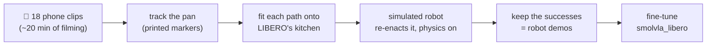

# Does the robot follow the words, or the scene?

**A one-word test for a robot foundation model, and teaching it the missing word with 20 minutes
of phone video.**

> 🚧 Work in progress: the phone videos are recorded, tracked and turned into robot
> demonstrations; fine-tuning and the final evaluation are next. Results will be filled in below.

---

## In plain words

Robot "brains" called **vision-language-action models (VLAs)** take a camera image and a written
instruction, and output arm motions. They score very well on the standard simulator benchmark
**LIBERO**. But in LIBERO every scene comes with exactly one instruction, so a model can score
well **without reading the instruction at all**, just by recognising the scene and replaying the
motion it memorised for it, like a student who passes a familiar exam by remembering where the
answers are, without reading the questions.

This project:
1. **tests** that with a **one-word change** to a LIBERO instruction, and
2. **tries to fix it with phone videos of me** doing the task in my own kitchen, turned into robot
   training data in the simulator, and compares that with the usual (expensive) way of collecting
   robot data.

## 1. The test: same kitchen, one word changed

LIBERO has a kitchen with a stove, a moka pot and a frying pan. The public model
[`smolvla_libero`](https://huggingface.co/HuggingFaceVLA/smolvla_libero) was trained in this
kitchen with only one instruction:

| | Instruction | In the model's training data? |
|---|---|---|
| **Original** (LIBERO-10, task 2) | "turn on the stove and put the **moka pot** on it" | ✅ yes |
| **Twin** (LIBERO-90, task 21) | "turn on the stove and put the **frying pan** on it" | ❌ never |

Both tasks use the **same scene and the same starting positions**; only the goal changes. If the
model **reads** the instruction it should pick up the frying pan; if it **replays its memory** of
this kitchen it goes for the moka pot.

**Result (unchanged model):**

| Instruction | Tries | Success | What happened |
|---|---|---|---|
| Sanity check, an easy LIBERO task (soup can into basket) | 10 | 7/10 | the setup works |
| **Original**: "…put the moka pot on it" | 3 | 2/3 | does the task it was trained on |
| **Twin**: "…put the frying pan on it" | 10 | **0/10** | never picked up the pan; sometimes went for the moka pot; often missed the stove knob |

**Change one word and the model stops working.** The twin task is officially part of LIBERO (it
even ships 50 demonstrations for it), the model just never trained on it.

## 2. The idea: teach the missing word with a phone

The usual way to teach a robot a new task is **teleoperation**: a person drives the robot
(real or simulated) through every demonstration with a joystick-like controller. That is slow
and needs equipment. Instead, I filmed myself putting a real pan on my real stove and turned the
videos into robot demonstrations in the simulator:



The key idea is **object-centric**: a human hand and a robot gripper move very differently, but
*"the pan rose 22 cm, travelled 51 cm left, turned 24° and landed on the burner"* means the same
thing for both. So the video is used only for **what happened to the pan**; the simulator supplies
everything robot-specific (how to grasp, the arm commands, the camera images the model learns
from).

### Filming and tracking

A printed marker inside the pan and a printed checkerboard on the stove let the camera measure the
pan's 3-D position and rotation in every frame, to well under a millimetre while it rests
([filming setup](docs/filming.md)).


All 18 takes, tracked:


| | 18 takes |
|---|---|
| frames where the pan was measured | 95-100 % (17 takes at 99-100 %) |
| carry distance | 48-53 cm (median 51.5 cm) |
| lift height | 20-25 cm (median 21.7 cm) |
| turn during the carry | median +24° |
| jitter while the pan sits still | 0.35-0.83 mm |

### From a phone path to a robot demonstration

For every take and every new arrangement of the kitchen objects:

1. **Fit the path onto LIBERO's kitchen.** It is rotated, scaled and shifted so that my start spot
   lands on the simulated pan and my burner on the simulated burner; the lift curve, the small
   sideways curve, the turn and the timing (sped up 1.5x) are kept.
2. **The simulated robot turns the stove knob and grasps the pan's handle** (scripted: these are
   the same for both instructions).
3. **It carries the pan along my path.** 20 times a second the controller compares where the
   *simulated* pan is with where my path says it should be, and sends the arm the 7 numbers that
   close the gap. The physics engine moves the arm and the pan; the simulated pan stays within
   about **half a centimetre** of my path.
4. **It places and releases the pan, and LIBERO's own success check decides.** Only successes are
   kept, recorded exactly as the model sees and acts: camera images, robot state, the 7-number
   actions, and the instruction.

Repeating this over many new arrangements of the objects turns 18 clips into many robot demos
(the idea behind MimicGen). Details, design choices and references:
[**How a phone clip becomes a robot demo**](docs/how-it-works.md).

## 3. The comparison

Three fine-tunes of `smolvla_libero`, identical except for where the frying-pan demos come from.
Each also gets LIBERO's moka-pot demos: since both tasks share the scene, the instruction is the
only way to tell them apart.

| Run | Frying-pan demos | Question it answers |
|---|---|---|
| **T** | LIBERO's 50 human **teleoperation** demos | the standard, expensive way (baseline) |
| **P** | the **same number** of phone-derived demos | are phone demos as good as teleop demos? |
| **Pall** | **all** phone-derived demos | what does multiplying 20 minutes of video buy? |

Every model is then tested on **both instructions** in LIBERO's 50 fixed test layouts (never used
for training), recording success and which object it picked up first:
- *frying pan*: did it learn to follow the new word?
- *moka pot*: did it keep the old skill, and still tell the two apart?

## 4. Results

*Coming after training.* The table will compare the unchanged model, T, P and Pall on both
instructions.

## What worked, and what didn't (so far)

- ✅ **Tracking the object, not the hand.** Printed markers gave a clean 3-D path for every take;
  the only hard case (pan tilted steeply toward the camera) is caught by plausibility checks.
- ✅ **Physics-checked demos.** Every robot demo was actually executed and passed LIBERO's own
  success check, and replays to success in LeRobot's evaluation environment.
- ⚠️ **A shallow camera angle** made the pan's rim hide part of the marker; a template-matching
  step over the whole marker fixed it.
- ⚠️ **One near-miss bug:** the demo generator first set the simulated robot up slightly differently
  from LeRobot's evaluation environment (robot start noise). Caught by an exact-replay check before
  any data was used.
- ⚠️ **About 1 in 5 random layouts can't be grasped** safely (the moka pot sits too close to the
  pan's handle). Those layouts are skipped, so the demos under-represent them.
- ℹ️ **Scripted parts:** the knob turn and the grasp are not learned from video; the video supplies
  the task itself (which object, where to, along which path), which is exactly what the unchanged
  model gets wrong.

## Run it yourself

Linux (LIBERO requirement). Tested with LeRobot 0.6 on Ubuntu 24.04, Python 3.12, NVIDIA GPU.

```bash
python3 -m venv .venv && source .venv/bin/activate
pip install "lerobot[libero,smolvla]"
python -c "import libero.libero"        # first run asks for a dataset path: answer n
```

**The zero-shot test**, with a log of what the robot did in every try:

```bash
MUJOCO_GL=egl python scripts/eval_with_log.py \
  --policy.path=HuggingFaceVLA/smolvla_libero \
  --policy.n_action_steps=10 --policy.num_steps=10 \
  --env.type=libero --env.task=libero_90 --env.task_ids='[21]' \
  --eval.n_episodes=10 --eval.batch_size=1 --output_dir=./eval_logs/pan_10ep
```

Use `--env.task=libero_10 --env.task_ids='[2]'` for the original moka-pot instruction. Keep
`--policy.n_action_steps=10 --policy.num_steps=10`: with the default (50) the model scored 0 even
on the task it was trained on. Saved videos play 4x faster than real time (`mpv --speed=0.25`).

**From phone clips to robot demos:**

```bash
# 1. camera calibration (clips of the printed board moved in front of the fixed phone)
python scripts/calibrate_camera.py calib_*.mov --out data/calibration/ipad_1080p.json
# 2. track the pan in each take, draw the tracking on the video, summarise all takes
python scripts/track_pan.py Demo1.mov --calib data/calibration/ipad_1080p.json --out tracks/Demo1
python scripts/render_tracking.py Demo1.mov tracks/Demo1/path.json --out tracks/Demo1/tracking.mp4
python scripts/summarize_tracks.py tracks --out tracks/summary
# 3. robot demos: every tracked take x new layouts, physics-checked, then a LeRobot dataset
MUJOCO_GL=egl python sim/make_demos.py tracks --layouts 3 --seed 0 --speedup 1.5 --max-steps 400 \
  --workers 3 --out demos/r0
python sim/write_lerobot_dataset.py demos/r0 --root datasets/phone_pan --fps 10
```

**Fine-tuning and evaluation:** [docs/training.md](docs/training.md).

## What's in this repository

| Path | What it is |
|---|---|
| `docs/how-it-works.md` | How phone clips become robot demos: method, design choices, references |
| `docs/filming.md`, `docs/img/filming_layout.png` | How the clips were recorded |
| `docs/training.md` | Building the datasets, fine-tuning, evaluating |
| `scripts/make_markers.py`, `assets/markers_letter.pdf` | Printable markers |
| `scripts/check_markers.py` | Checks a test clip: are the board and the pan marker found? |
| `scripts/calibrate_camera.py`, `data/calibration/ipad_1080p.json` | Camera calibration, and the result for the iPad used |
| `scripts/track_pan.py` | Tracks the pan: its 3-D path relative to the board, phases, quality numbers |
| `scripts/render_tracking.py`, `scripts/summarize_tracks.py` | Tracking drawn on the video; one figure and table for all takes |
| `sim/kitchen_controller.py` | The robot's scripted pieces in LIBERO: knob turn, handle grasp, carry, place |
| `sim/real_path.py` | Fits a tracked path onto LIBERO's kitchen and has the robot follow it |
| `sim/make_demos.py` | Tracked paths x new layouts -> physics-checked robot demos |
| `sim/write_lerobot_dataset.py`, `sim/check_demo_conventions.py` | LeRobot dataset writer; check against LeRobot's evaluation environment |
| `train/` | Dataset building (moka subset, teleop demos, phone demos, merges), training and evaluation scripts |
| `scripts/eval_with_log.py`, `scripts/watch_eval.py` | LeRobot evaluation with a per-try behaviour log / a live window |
| `scripts/check_kitchen_render.py`, `scripts/replay_demo.py` | Pictures of the two kitchen tasks; replay of a LIBERO teleop demo |
| `scripts/render_scenes.py`, `render_all_parallel.py`, `make_sheets.py` | Pictures of all 130 LIBERO tasks |

## Glossary

- **VLA (vision-language-action model):** a neural network that maps camera images and an
  instruction to robot motions.
- **LIBERO:** a robot simulator with 130 standard tasks, used to compare VLAs.
- **Demo (demonstration):** a recording of a task being done: what the cameras saw and the arm
  command at every step. Models learn by imitating demos.
- **Teleoperation:** a person drives the robot live to record demos.
- **Zero-shot:** testing a model on something it was never trained on, without retraining it.
- **Fine-tuning:** continuing to train an already-trained model on a small amount of new data.
- **Object-centric:** describing a demonstration by what happened to the object, not by the hand.

## Related work

LIBERO; SmolVLA and LeRobot; LIBERO-PRO, LIBERO-Plus and LangGap (VLAs that don't follow the
instruction); MimicGen, DemoGen, Real2Render2Real, X-Sim (turning a few demos or human videos into
robot data). Full list with links: [docs/how-it-works.md](docs/how-it-works.md#references).
