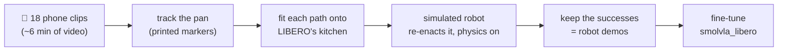
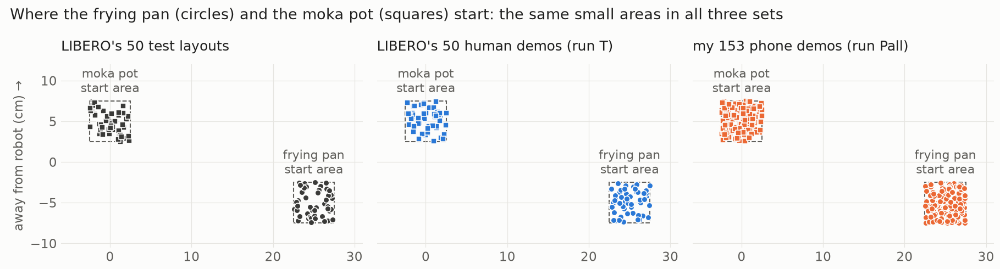
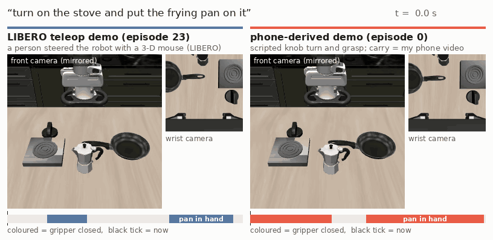
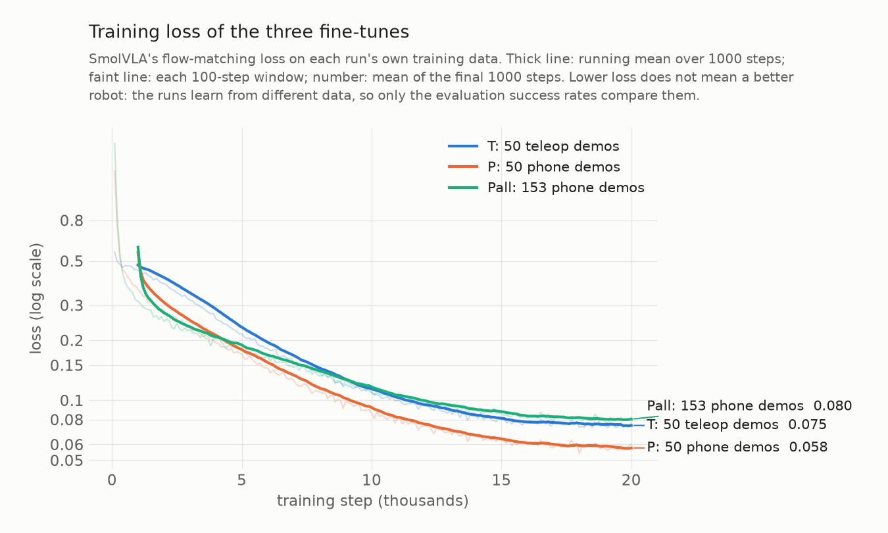

# Does the robot follow the words, or the scene?

**A one-word test for a robot foundation model, and teaching it the missing word with 18 short
phone clips (about 6 minutes of video).**


*Left: the public model, told to put the **frying pan** on the stove, puts the **moka pot** there,
the task it was trained on in this kitchen (it does so in 12 of its 50 tries; in the other 38 it
lifts nothing). Middle and right: after fine-tuning with demos made from my phone videos (run Pall),
the same kind of model puts on the stove whichever object it is told. Three chosen tries in
LIBERO's test layouts, real time.*

## In short

- **Finding:** the public model `smolvla_libero` does LIBERO's "turn on the stove and put the
  **moka pot** on it" (26/50 test layouts), but change one word to "**frying pan**" (same
  kitchen, a LIBERO task it never trained on) and it succeeds **0/50** times. It never even moves
  the pan: it lifts nothing in 38 tries and the moka pot in 12. The new word throws it off, but
  never points it to the pan.
- **Idea:** teach the missing word with phone videos of me moving a real pan in my kitchen.
  Printed markers give the pan's 3-D path; a simulated robot re-enacts each path in LIBERO's
  kitchen, with physics, over many new arrangements of the objects; the successes become
  **153 robot demonstrations**.
- **Comparison:** fine-tune on LIBERO's 50 human-teleoperated demos (**T**), on 50 phone-derived
  demos (**P**), or on all 153 phone-derived demos (**Pall**), and test every model on both instructions in
  LIBERO's 50 test layouts.
- **Result:** after fine-tuning, every model goes for the object the word names (the other object
  came first in 1 of 300 tries) and keeps the original task. Phone-derived demos (knob turn and
  grasp scripted, the carry from the video) take the frying pan from **0 to 62%** (Pall) against
  **90%** with LIBERO's human demos. Where the moka pot does not start close to the pan, Pall nearly
  matches the human-trained model (23/25 vs 24/25); where it starts close, Pall loses (8/25 vs
  21/25), and why is not settled yet ([section 4](#4-results)).

| Success in LIBERO's 50 test layouts | "…put the **frying pan** on it" | "…put the **moka pot** on it" |
|---|---|---|
| unchanged `smolvla_libero` | **0/50** | 26/50 |
| **T**: + 50 human teleoperation demos | **45/50** | 35/50 |
| **P**: + 50 phone-derived demos | **18/50** | 32/50 |
| **Pall**: + 153 phone-derived demos | **31/50** | 34/50 |

---

## In plain words

Robot "brains" called **vision-language-action models (VLAs)** take a camera image and a written
instruction, and output arm motions. They score very well on the standard simulator benchmark
**LIBERO**. But in most LIBERO tasks the scene alone gives the task away (each arrangement of
objects comes with a single instruction; LIBERO-Goal is the exception), so a model can score well
there **without reading the instruction at all**, just by recognising the scene and replaying the
motion it memorised for it, like a student who passes a familiar exam by remembering where the
answers are, without reading the questions.

This project:
1. **tests** that with a **one-word change** to a LIBERO instruction, and
2. **tries to fix it with phone videos of me** doing the task in my own kitchen, turned into robot
   training data in the simulator, and compares that with the usual (expensive) way of collecting
   robot data.

## 1. The test: same kitchen, one word changed

LIBERO has a kitchen with a stove, a moka pot and a frying pan. The public model
[`smolvla_libero`](https://huggingface.co/HuggingFaceVLA/smolvla_libero) was trained on this
kitchen with only one instruction:

| | Instruction | In the model's training data? |
|---|---|---|
| **Original** (LIBERO-10, task 2) | "turn on the stove and put the **moka pot** on it" | ✅ yes |
| **Twin** (LIBERO-90, task 21) | "turn on the stove and put the **frying pan** on it" | ❌ never |

Both tasks use the **same scene, the same objects and the same placement regions** (their task
files differ only in the goal; their fixed start layouts differ by a few cm). If the model
**reads** the instruction it should at least go for the frying pan (which it has seen in this
kitchen but never handled in training); if it **replays its memory** of this kitchen it goes for
the moka pot.

**First look (unchanged model, a few tries):**

| Instruction | Tries | Success | What happened |
|---|---|---|---|
| Sanity check, an easy LIBERO task (soup can into basket) | 10 | 7/10 | the setup works |
| **Original**: "…put the moka pot on it" | 3 | 2/3 | does the task it was trained on |
| **Twin**: "…put the frying pan on it" | 10 | **0/10** | never picked up the pan; sometimes went for the moka pot; often missed the stove knob |

**Change one word and the model stops working.** The twin task is officially part of LIBERO (it
even ships 50 demonstrations for it); the model just never trained on it. The full evaluation on
all 50 test layouts ([section 4](#4-results)) confirms it: 0/50 on the frying pan, 26/50 on the
moka pot. LIBERO gives the twin task 400 control steps (20 s) and the moka-pot task 520.

## 2. The idea: teach the missing word with a phone

The usual way to teach a robot a new task is **teleoperation**: a person drives the robot
(real or simulated) through every demonstration with a joystick-like controller. That is slow
and needs equipment. Instead, I filmed myself putting a real pan on my real stove and turned the
videos into robot demonstrations in the simulator:



The key idea is **object-centric**: a human hand and a robot gripper move very differently, but
*"the pan rose 22 cm, travelled 51 cm left, turned 24° and landed on the burner"* means the same
thing for both. So the video is used only for **what happened to the pan**; the simulator supplies
everything robot-specific (how to grasp, the arm commands, the camera images the model learns
from).


*Left: one of my takes with the tracking drawn on it. Right: the simulated robot carrying the pan
along the same path in a new arrangement of the kitchen, seen by the two cameras the model learns
from ([still version](docs/img/real_vs_sim.jpg)).*

### Filming and tracking

A printed marker inside the pan and a printed checkerboard on the stove let the camera measure the
pan's 3-D position and rotation in every frame (jitter under 1 mm while it rests; an independent
re-implementation of the tracker agreed to 0.4 cm on a test clip). How the clips were filmed:
[docs/filming.md](docs/filming.md).


All 18 takes, tracked:


| | 18 takes |
|---|---|
| video | 18-22 s per take, 357 s in total (9 takes at 60 fps, 9 at 30 fps) |
| frames where the pan was measured | 95-100 % (17 takes at 99-100 %) |
| carry distance | 48-53 cm (median 51.5 cm) |
| lift height | 20-25 cm (median 21.7 cm) |
| carry time | 7.3-10.9 s (median 8.4 s) |
| turn during the carry | median +24° (-53° to +30°) |
| jitter while the pan sits still | 0.35-0.83 mm |

### From a phone path to a robot demonstration

For every take and every new arrangement of the kitchen objects:

1. **Fit the path onto LIBERO's kitchen.** It is rotated, scaled (by about 0.8: my ~51 cm become
   the simulator's ~41 cm) and shifted so that my start spot lands on the simulated pan and my
   burner on the simulated burner. The lift curve, the small sideways curve, the turn and the
   timing are kept, with two changes: the carry is played 1.5x faster (so the whole task fits the
   20 s limit; the pan's speed is also capped at 0.25 m/s), and where the pan would pass within
   2 cm of the simulated moka pot (my counter has none), that stretch of the path is raised (by
   about 9 cm, in 1 demo in 5).
2. **The simulated robot turns the stove knob and grasps the pan's handle.** Both are scripted: the
   knob turn is the same as in the moka-pot task; the grasp is a top-down grasp of the handle,
   chosen to keep the wide gripper clear of the moka pot.
3. **It carries the pan along my path.** 20 times a second the controller compares where the
   *simulated* pan is with where my path says it should be 0.2 s later, and sends the arm the 7
   numbers (hand move x/y/z, hand turn x/y/z, gripper) that close the gap. The physics engine
   moves the arm and the pan; the simulated pan typically stays within **half a centimetre** of
   the fitted path (median 0.43 cm RMS; median 1.6 cm where the path had to be raised; demos
   above 2 cm are discarded).
4. **It places and releases the pan, and LIBERO's own success check decides.** Only successes are
   kept, recorded exactly as the model sees and acts: both camera images, the robot state, the
   7-number actions, and the instruction.

Repeating this over new random arrangements of the objects (the idea behind MimicGen) turned
17 of the 18 takes into **153 robot demos**, 9 per take (222 arrangements tried; details below).
They are public on Hugging Face in LeRobot format:
[`Delcastillo8/libero90_frying_pan_phone`](https://huggingface.co/datasets/Delcastillo8/libero90_frying_pan_phone)
(all 153) and [`Delcastillo8/libero90_frying_pan_phone_50`](https://huggingface.co/datasets/Delcastillo8/libero90_frying_pan_phone_50)
(the 50 of run P); the "Visualize this dataset" button on each page plays every episode.
Method, design choices and references: [**How a phone clip becomes a robot demo**](docs/how-it-works.md).

## 3. The comparison

Three fine-tunes of `smolvla_libero`, identical except for where the frying-pan demos come from.
Each also gets LIBERO's moka-pot demos: since both tasks share the scene, the instruction is the
only way to tell them apart.

| Run | Frying-pan demos | Question it answers |
|---|---|---|
| **T** | LIBERO's 50 human **teleoperation** demos | the standard, expensive way (baseline) |
| **P** | **50** phone-derived demos (spread evenly over the takes) | are phone demos as good as teleop demos at the same count? |
| **Pall** | **all 153** phone-derived demos | what does multiplying 6 minutes of video buy? |

All runs use the same training steps and settings (20 000 steps, batch 32). Pall therefore sees
each of its demos less often than P does (about 12 passes over its data instead of 26), and its 41
moka-pot demos are a smaller share of its training episodes (21 % instead of 45 %).

Every model, and the unchanged one, is then tested on **both instructions** in LIBERO's 50 fixed
test layouts, recording success and which object it picked up first:
- *frying pan*: did it learn to follow the new word?
- *moka pot*: did it keep the old skill, and still tell the two apart?

Neither training set starts from the 50 test layouts, but all three draw from the same small
start areas: LIBERO lets the pan and the moka pot start anywhere inside a 5 x 5 cm square each,
and every phone demo uses a new random draw from them, as LIBERO's own human demos and test
layouts do. The nearest test layout is 0.3-2.5 cm away for the phone demos (median 1.2 cm, pan +
moka pot positions) and 0.5-2.1 cm for LIBERO's teleop demos: the same situation for both.



Spreading the pan wider, as MimicGen does for robustness, was a deliberate no: the test only
uses these areas, and LIBERO's human demos come from them too, so wider layouts would change what
P is compared with and would not show in the results. Robustness to new placements is a natural
next step with its own wider test layouts.

### What the two kinds of frying-pan demos look like



*Left: one of LIBERO's 50 teleop demos, a person steering the robot with a 3-D mouse. Right: one
phone-derived demo (knob turn and grasp scripted; the carry follows my pan's path from a phone
clip). Same task and simulator, the two cameras the model learns from (mirrored left-right, as
LIBERO stores them). The bar under each side shows when the gripper is closed.*

Over all 50 demos of each ([gripper paths of every demo](docs/img/teleop_vs_phone_paths.png),
[full table](docs/img/teleop_vs_phone.md)):

| median | LIBERO teleop (run T) | phone-derived (run P) |
|---|---|---|
| demo length | 13.7 s | 13.8 s |
| pan grasped at | 9.2 s | 6.8 s |
| time with the pan in hand | 3.8 s | 6.8 s |
| pan moved, grasp to release | 44 cm | 40 cm |
| pan lifted above the grasp | 21 cm | 24 cm |
| fastest 5 % of steps | 25 cm/s | 41 cm/s |
| gripper closed | 45 % of steps | 84 % of steps |

Same length, height and distance, but a different rhythm: the people take longer to turn the knob
and reach the handle (grasp at 9.2 s vs 6.8 s) and then carry the pan faster; the scripted robot
reaches at full speed, pushes the knob with closed fingers (hence 84 %) and carries the pan at the
pace of my video (sped up 1.5x).

## 4. Results

Every model was tested on both instructions, each in that task's 50 LIBERO test layouts (LIBERO-90
task 21 for the frying pan, LIBERO-10 task 2 for the moka pot; the two sets differ by a few cm),
one try per layout. Per-try logs: [`results/`](results/); the summary with every pairwise test:
[`results/summary.md`](results/summary.md); every other number in this section:
`python scripts/analyze_results.py`.

| Successes out of 50 (95 % interval) | "…put the **frying pan** on it" (new) | "…put the **moka pot** on it" (original) |
|---|---|---|
| unchanged `smolvla_libero` | **0/50** (0-7 %) | 26/50 (39-65 %) |
| **T**: + 50 human teleoperation demos | **45/50** (79-96 %) | 35/50 (56-81 %) |
| **P**: + 50 phone-derived demos | **18/50** (24-50 %) | 32/50 (50-76 %) |
| **Pall**: + 153 phone-derived demos | **31/50** (48-74 %) | 34/50 (54-79 %) |

| First object lifted (> 3 cm) | told "frying pan": pan / moka pot / nothing | told "moka pot": moka pot / pan / nothing |
|---|---|---|
| unchanged | 0 / 12 / 38 | 28 / 0 / 22 |
| T | 46 / 0 / 4 | 35 / 0 / 15 |
| P | 23 / 0 / 27 | 32 / 0 / 18 |
| Pall | 32 / 1 / 17 | 36 / 0 / 14 |

**1. The unchanged model does not follow the new word.** Told "frying pan", it never lifts the pan
or even moves it; it lifts nothing in 38 of 50 tries and the moka pot in the other 12 (told "moka
pot", it lifts the moka pot in 28; p = 0.002). The word throws it off, but does not point it to
the pan.

**2. Every fine-tune goes for the object the word names, in both directions, and keeps the old
task.** Told "frying pan", what they lift is the pan (the moka pot came first in 1 of 150 tries);
told "moka pot", they never lift the pan first. Moka-pot success is 64-70 % against 52 % before
(none of these differences is significant, p ≥ 0.1). After training on both instructions in the
same kitchen, the instruction picks the object, and the original skill is not measurably worse.

**3. Phone demos teach the new instruction, less well than human robot demos.** Frying pan: 36 %
with 50 phone demos, 62 % with 153, 90 % with LIBERO's 50 teleoperation demos (all far above 0:
p < 1e-5; T vs Pall p = 0.002; Pall vs P p = 0.016). The phone-trained models rarely fail by
picking the wrong object: they fail without ever lifting the pan (P: 27 of its 32 failures;
Pall: 18 of 19), mostly without touching it either (the pan moved more than 1 cm in only 4 and 3
of these, the moka pot in 10 and 12). T's few failures are fumbles: it moved the pan in all 4.

**4. They lose in the tight layouts.** Splitting the 50 test layouts by how far the moka pot
starts from the pan (distance between their centres; median 27 cm):

| Frying-pan success | moka pot closer (22-27 cm) | moka pot farther (27-31 cm) |
|---|---|---|
| T | 21/25 | 24/25 |
| P | 4/25 | 14/25 |
| Pall | 8/25 | **23/25** |

When the moka pot is farther away, Pall nearly matches the model trained on human demos (23/25 vs
24/25; P: 14/25). When it is close, Pall bumps the moka pot (moved > 1 cm in 12 of the 25 closer
tries, 1 of the 25 farther ones) and mostly fails (8/25; closer vs farther p = 0.00002). T holds
up better, but not fully: 4 of its 5 failures are among the 6 tightest starts (under 25 cm it
succeeds 5/9, above 40/41; p = 0.003). I chose the split after seeing the results; a rank test on
the start distance itself, without a cut, agrees for all three (P p = 0.001, Pall p = 0.00008,
T p = 0.007).

Why the phone-trained models struggle there is not settled. Their demos start in tight layouts
less often: 38 % of the phone demos start in the closer half, against 50 % of the test layouts and
62 % of LIBERO's human demos (closer than 25 cm: 9 %, 18 % and 22 %), because the demo generator
drops layouts in which its scripted grasp disturbs the moka pot or lets the pan slip
([what didn't work](#what-worked-and-what-didnt)). But in number Pall still has more closer-half
demos than T (58 vs 31), and it loses most between 25 and 27 cm (5/16, T 16/16). The scripted
grasp also changes near the moka pot (at an angle, with the pan turning in the gripper), so
tight-layout phone demos may simply be harder to imitate. A next version should test both: keep
the tight layouts, and give them a cleaner grasp.

**5. The models picked up the timing of their demos.** The phone-trained models turn the knob and
lift the pan earlier than T (median first lift at step 160 and 162, i.e. 8.0 and 8.1 s,
against 194, 9.7 s), as the phone demos grasp earlier than the human ones (6.8 s vs 9.2 s, section 3).
On the moka-pot instruction, where all three learned from the same demos, they lift at the same
time (median step 196-206).

**Training loss.** All three runs converged (20 000 steps, batch 32, about 4 h each on an H100,
P and Pall sharing one; data loading, not the GPU, set the pace: [docs/training.md](docs/training.md)).



*P ends with the lowest loss (0.058; T 0.075, Pall 0.080) yet the lowest success of the three,
most likely because its 50 scripted demos are more alike than human ones (grasp at 6.6-7.2 s against 7.9-12.4 s) and each is seen 26 times; Pall's 153, of the same kind but seen 12 times each, end highest. The loss is measured on each run's own
data, so it shows convergence, not which model is better. Table: [train_loss.md](docs/img/train_loss.md).*

**How to read these numbers**
- 50 tries per cell: the 95 % interval is about ±13 points around 50 %, so only differences with
  p < 0.05 (two-sided Fisher exact test) are called differences above.
- Pall differs from P in more than the number of demos: more start layouts, about half as many
  passes over its data, and a smaller moka-pot share. "More phone demos helped" is the result;
  it is not attributable to the count alone.
- In the phone demos the knob turn and the grasp are scripted and the video supplies the carry,
  so P vs T compares "scripted robot + phone path" with human teleoperation, not video alone.
- One person, one kitchen, one pan, one pair of instructions, in simulation.
- Evaluation: [`train/eval.sh`](train/eval.sh) (`lerobot-eval` with a per-try log),
  `n_action_steps=10`, `num_steps=10`, LIBERO's step limits (400 frying pan, 520 moka pot),
  LeRobot's default render size (360x360, while all training images are 256x256; the same for every
  model); run on a laptop GPU (RTX 3050, 4 GB) with LeRobot 0.6.2, not on the H100s used for training.
- The p-values are not corrected for the number of tests: over the six frying-pan comparisons, a
  Bonferroni correction would drop Pall vs P (p = 0.016).

## Design choices

- **A same-kitchen, one-word twin test.** In most LIBERO suites each scene comes with a single
  instruction, so a model can pass without reading it. The moka-pot task and its frying-pan twin
  share the scene, the objects and the start areas and differ by one word: a controlled contrast
  in which only reading the instruction helps.
- **Track the object, not the hand.** The challenge's own example drives the robot from a video of
  a hand. A hand is a different body from a two-finger gripper, and what matters in this task is
  where the pan goes. Markers give a millimetre-level 3-D path of the pan from one phone; how the
  robot grasps the pan is solved separately, in the simulator.
- **Printed markers, not learned pose estimation.** A ChArUco board on the stove defines the world
  frame; an ArUco marker in the pan gives its position and rotation in every frame. With a few days
  for the whole project I wanted tracking that works the first time and can be checked (jitter under
  1 mm at rest), not a model to train and debug.
- **A scripted knob turn and grasp.** The video cannot show them in a form the robot can use: my
  fingers on a knob or a handle say little about what a two-finger gripper should do. The script
  does both; the video supplies the carry.
- **Re-enact each path with physics in LIBERO, keep only successes.** Every demo is executed, not
  just drawn, and passes LIBERO's own success check, so the model never imitates a motion the robot
  cannot do. Replaying each path in many random layouts is the MimicGen idea.
- **Fine-tune `smolvla_libero`, not a new or bigger model.** It already knows this kitchen and the
  moka-pot task, and it runs on a 4 GB laptop GPU for evaluation. The question is whether a few
  demos can add one word to an existing model; training from scratch would answer a different one.
- **Train on LIBERO's 41 moka-pot demos too.** Same scene, two instructions: only the word tells
  them apart, so the model has to read it. They also keep the old task from being forgotten.
- **LIBERO's own teleop demos, at the same count, as the baseline.** 50 human demos of the same
  task, from the benchmark itself: a fair, same-task comparison for 50 phone demos (P vs T).
- **The same two start areas as the test.** The test only uses LIBERO's two 5 x 5 cm start areas, and its human
  demos come from them too, so the phone demos do as well (section 3).

## What worked, and what didn't

In short: phone demos taught the new word (frying pan 0 to 62 %) without costing the old task, but
less well than LIBERO's human demos, mainly in tight layouts ([section 4](#4-results)).

**Worked**

- **Tracking the object, not the hand.** Printed markers gave a clean 3-D path for every take. The
  pan's rim partly hid the marker (the camera looked down only 34°); matching a template of the
  whole marker fixed that, and outlier checks removed false detections (frames in 3 takes).
- **Physics-checked demos.** Every robot demo was executed and passed LIBERO's own success check.
  6 spot-checked demos rebuild pixel-identically in LeRobot's evaluation environment and replay to
  success at the same step (one a step later).
- **`n_action_steps=10`.** SmolVLA plans 50 actions (2.5 s) at a time. With
  `n_action_steps=50` the robot carries out all 50 before looking again, and the model scored 0
  even on the task it was trained on; with 10 (0.5 s) it works. Every command here sets it.
- **Normalization pinned to `smolvla_libero`'s own.** `lerobot-train` replaces a pretrained
  policy's state and action statistics with the dataset's. [`train/pin_norm_stats.py`](train/pin_norm_stats.py)
  writes the pretrained ones into every merged dataset, so fine-tuning does not change how actions
  are scaled, and the three runs differ only in their demos.

**Didn't work, or needed a fix**

- **Phone-trained models lose in tight layouts.** When the moka pot starts close to the pan, Pall
  bumps it and succeeds 8/25 times (T 21/25); farther away it nearly matches T (23/25 vs 24/25).
  The phone demos have fewer tight starts, but why Pall loses there is not settled ([section 4](#4-results)).
- **About 1 in 5 random layouts gave no usable demo** (42 of 195 for the 17 usable takes: 20 strayed
  more than 2 cm from the path, 17 failed the task, 5 nudged the moka pot), often with the moka pot
  next to the pan's handle (no collision-free grasp in 38 of the 222 layouts tried; only 8 of those
  were kept). New layouts replace them, so tight layouts are under-represented.
- **One take gave no demos.** In Demo9 I turned the pan 53° during the carry; in all 27 layouts
  tried, the simulated pan strayed 3-4 cm from the path, knocked the moka pot or failed.
- **The pan turns in the robot's grasp** (median 12°, over 20° in a third of the demos, up to 35°).
  The controller steers on the pan itself, so the pan still follows the path, but the arm moves
  differently from a clean carry.
- **One near-miss bug.** The demo generator first set up the simulated robot slightly differently
  from LeRobot's evaluation environment (robot start noise). The exact-replay check caught it
  before any data was used.
- **The LeRobot copy of LIBERO has a stale index.** The episode index of `HuggingFaceVLA/libero`
  points most episodes at the wrong data file (it was written for 69 files; the data now sits in
  377), so LeRobot fetched the wrong files and failed. [`train/make_moka_subset.py`](train/make_moka_subset.py)
  reads the real files' row counts and repairs the index in its local copy.
- **Data loading, not the GPU, set the training pace.** In a 200-step trial an update took 0.20 s
  and waiting for its data 0.58 s: LIBERO's data keeps the camera images inside the parquet files,
  and LeRobot 0.6.1 decodes all 50 rows behind each 50-step action chunk, both images included.
  With 12 data workers, P and Pall sharing one H100 took 3.9 and 3.7 h, T alone 4.0 h.
- **An interrupted evaluation could pass as finished.** [`train/eval.sh`](train/eval.sh) first
  skipped every task whose output folder existed, including runs cut short. Now a task counts as
  done only when its `.meta.json` exists (written at the end); an unfinished one is redone.

**Limits to keep in mind**

- **Scripted parts.** The knob turn and the grasp are scripted, so *which object* is picked up (the
  pan, by its handle) is fixed by the script for this task. The video supplies the carry: where the
  pan goes, along which path, how high and how fast.
- **What P vs T can and cannot show.** The phone demos' arm motions come from a scripted controller,
  T's from people, and their rhythm differs (section 3). A run with the scripted carry alone (no
  video path) would separate the two; it is not one of the three runs.

## Reproduce

Linux (LIBERO needs it). One environment (LeRobot 0.6.1) runs everything below. I evaluated with
LeRobot 0.6.2 built from source (table below) and did not evaluate with 0.6.1.

```bash
git clone https://github.com/pd05849/HumanoidAI_challenge.git
cd HumanoidAI_challenge
sudo apt-get update && sudo apt-get install -y build-essential cmake libosmesa6 libgl1 ffmpeg
#   compilers + cmake: one of LIBERO's packages builds from source; OSMesa: CPU rendering;
#   ffmpeg: tracking and comparison videos
curl -LsSf https://astral.sh/uv/install.sh | sh   # uv, to get Python 3.12 (LeRobot 0.6.1 needs >= 3.12)
source $HOME/.local/bin/env                        # puts uv on the PATH in this shell
uv venv --python 3.12 .venv
source .venv/bin/activate
uv pip install "lerobot[libero,smolvla,training]==0.6.1"
python -c "import libero.libero"                   # first run asks for a dataset path: answer n
MUJOCO_GL=egl python scripts/check_env.py          # MUJOCO_GL=osmesa without an NVIDIA GPU
```

This one install also brings LIBERO's simulator (the same versions as in the first row below),
SciPy, Matplotlib, h5py, PyAV and OpenCV with `cv2.aruco`. If `import libero` fails because an old
`~/.libero` config points at a deleted environment: `rm -rf ~/.libero` and run it again.

What was used:

| Step | Machine | OS | Python | Software | `MUJOCO_GL` |
|---|---|---|---|---|---|
| Tracking, demo generation | CPU only | Linux | 3.11 (venv) | hf-libero 0.1.4, robosuite 1.4.0, MuJoCo 3.8.1, OpenCV 5.0 | `osmesa` |
| Datasets, training | Lambda Cloud, 2x H100 SXM5 80 GB | Ubuntu 22.04 | 3.12 (uv; the system's 3.10 is too old) | LeRobot 0.6.1 | `osmesa` (the NVIDIA EGL vendor file was missing) |
| Evaluation | my laptop, RTX 3050 4 GB | Ubuntu 24.04 | 3.12.3 | LeRobot 0.6.2, built from source (commit `4aaff99b`, 28 Aug 2026) | `egl` |

### (a) Evaluate the published models (NVIDIA GPU, 4 GB is enough)

Without a GPU: `python train/summarize_evals.py results --names base T P Pall` rebuilds
[`results/summary.md`](results/summary.md) (successes, 95 % intervals, pairwise tests) and
`python scripts/analyze_results.py` recomputes the other numbers in section 4, both from my
per-try logs in [`results/`](results/).

**A quick look:** 10 tries of the unchanged model on the frying-pan instruction, with a log of what
the robot did in every try:

```bash
MUJOCO_GL=egl python scripts/eval_with_log.py \
  --policy.path=HuggingFaceVLA/smolvla_libero \
  --policy.n_action_steps=10 --policy.num_steps=10 \
  --env.type=libero --env.task=libero_90 --env.task_ids='[21]' \
  --eval.n_episodes=10 --eval.batch_size=1 --output_dir=./eval_logs/pan_10ep
```

Use `--env.task=libero_10 --env.task_ids='[2]'` for the original moka-pot instruction. Keep
`--policy.n_action_steps=10 --policy.num_steps=10`: with `n_action_steps=50` (run the
whole 50-step action chunk before looking again) the model scored 0 even on the task it was
trained on. Saved videos play 4x faster than real time (`mpv --speed=0.25`). To run it again,
first `rm -rf eval_logs/pan_10ep eval_logs/pan_10ep_episodes.jsonl` (the per-try log is appended to).

**The full evaluation** (section 4): both instructions, 50 tries each, for the unchanged model and
the three fine-tunes (Hugging Face model repos with the `last` checkpoint and its training log):

```bash
bash train/eval.sh HuggingFaceVLA/smolvla_libero base
bash train/eval.sh Delcastillo8/smolvla_libero_frying_pan_T T
bash train/eval.sh Delcastillo8/smolvla_libero_frying_pan_P P
bash train/eval.sh Delcastillo8/smolvla_libero_frying_pan_Pall Pall
python train/summarize_evals.py eval_logs --names base T P Pall --md eval_logs/summary.md  # vs results/summary.md
python scripts/analyze_results.py --root eval_logs
python scripts/make_rollout_gif.py base:pan:6 Pall:pan:2 Pall:moka:0 --out docs/img/rollouts.gif
```

| `train/eval.sh` | |
|---|---|
| writes | `eval_logs/<name>/{pan,moka}/` (`lerobot-eval` output, videos of the first 10 tries only), `{pan,moka}_episodes.jsonl` (per try), `.log`, `.meta.json` |
| skips | a task whose `.meta.json` exists (written at the end of a finished run); an unfinished one is redone |
| `ONLY=pan` or `ONLY=moka` | runs one task; `FORCE=1` redoes a finished one |
| `EVAL_RES` | leave it unset to match my results (LeRobot's default render size) |

To work from local copies, download a model inside the repository folder and pass its path:

```bash
hf download Delcastillo8/smolvla_libero_frying_pan_T --local-dir outputs/models/T
bash train/eval.sh outputs/models/T T
```

A path that does not exist is taken by LeRobot as a Hub repo id, and fails. With all three models
downloaded, the training-loss figure comes from their `train.log` files:

```bash
python scripts/plot_loss.py outputs/models/T/train.log outputs/models/P/train.log \
    outputs/models/Pall/train.log --out docs/img/train_loss
```

### (b) Rebuild the datasets and retrain (H100, about 4 h per run)

The phone datasets come from Hugging Face, so this step needs no clips:

```bash
PHONE_DATASET=Delcastillo8/libero90_frying_pan_phone_50 \
PHONE_ALL_DATASET=Delcastillo8/libero90_frying_pan_phone \
  bash train/build_datasets.sh
STEPS=200 SAVE_FREQ=200 bash train/train.sh P smoke    # timing trial: updt_s and data_s in the log
NUM_WORKERS=12 bash train/train.sh T
NUM_WORKERS=12 bash train/train.sh P
NUM_WORKERS=12 bash train/train.sh Pall
```

- **Datasets.** Give both `PHONE_*` variables (there are no defaults): without `PHONE_DATASET`
  there is no P, without `PHONE_ALL_DATASET` no Pall (T is always built). It downloads the moka-pot demos, the
  teleop demos (re-rendered in LIBERO) and my phone datasets, merges them and pins their
  normalization statistics.
  `outputs/datasets/logs/check_sources.log` should say `ALL COMPATIBLE`; mine had 41 moka-pot
  episodes (10,866 frames) and kept all 50 teleop demos. The script renders with
  `MUJOCO_GL=egl` unless told otherwise; on my cloud machine EGL was missing, so I set
  `MUJOCO_GL=osmesa`. Plan for at least 50 GB of free disk: the datasets alone are over 20 GB
  ([docs/training.md](docs/training.md), section 1).
- **Training.** 20 000 steps, batch 32, seed 1000 (the `train/train.sh` defaults). I ran T alone on
  one H100 and P and Pall together on the other (prefix each command with
  `CUDA_VISIBLE_DEVICES=0` or `1`, one terminal each): T 4.0 h, P 3.9 h, Pall 3.7 h. Each run writes
  `outputs/train/<RUN>/checkpoints/{005000,...,last}/pretrained_model` and the log
  `outputs/train/<RUN>.log`; I report `last`. The messages "DataLoader worker ... killed by signal:
  Aborted" and "terminate called without an active exception" at exit come after the last
  checkpoint is saved, and are harmless.
- **Then** evaluate as in (a), into a separate folder so earlier results are not mistaken for
  yours, e.g. `EVAL_ROOT=eval_logs_mine bash train/eval.sh outputs/train/T/checkpoints/last/pretrained_model T`
  (`train/eval.sh` skips a name that already has a finished run; `FORCE=1` redoes it), then
  `python scripts/analyze_results.py --root eval_logs_mine`, and plot the loss from
  `outputs/train/T.log`, `P.log`, `Pall.log`.

Every step, its checks and troubleshooting: [docs/training.md](docs/training.md).

### (c) Phone demos: regenerate mine, or film your own

The raw clips are not published (video files are git-ignored; the clips stay private). What the
robot demos are made from is published: the tracked pan path of each of the 18 takes, in
[`data/tracks/`](data/tracks/) (numbers only; [summary](data/tracks/summary.md)). Step 3
regenerates the phone demos from them; steps 1-2 are for your own clips. For those, print
[`assets/markers_letter.pdf`](assets/markers_letter.pdf) at 100 % (or make it with
`python scripts/make_markers.py`), film as in [docs/filming.md](docs/filming.md), and check a short
test clip first with `python scripts/check_markers.py test.mov`.

```bash
# 1. camera calibration (clips of the printed board moved in front of the fixed phone)
python scripts/calibrate_camera.py calib_*.mov --out data/calibration/my_camera.json
# 2. track the pan in each take, draw the tracking on the video, summarise all takes
python scripts/track_pan.py Demo1.mov --calib data/calibration/my_camera.json --out tracks/Demo1
python scripts/render_tracking.py Demo1.mov tracks/Demo1/path.json --out tracks/Demo1/tracking.mp4
python scripts/summarize_tracks.py tracks --out tracks/summary
# 3. robot demos: every tracked take x new layouts, physics-checked
#    (3 rounds x 3 kept layouts per take; seeds 0/100/200 give different layouts).
#    data/tracks = the 18 published takes; use tracks for your own. osmesa renders on the CPU
#    (what was run); MUJOCO_GL=egl works too, on an NVIDIA GPU.
for r in 0 1 2; do
  MUJOCO_GL=osmesa python sim/make_demos.py data/tracks --layouts 3 --seed $((100*r)) --speedup 1.5 \
    --max-steps 400 --workers 3 --out demos/r$r
done
python sim/summarize_demos.py demos/r0 demos/r1 demos/r2
# 4. LeRobot datasets: 50 demos spread over the takes (run P), and all of them (run Pall)
python train/convert_phone_npz.py demos/r0 demos/r1 demos/r2 --fps 10 --max-episodes 50 --out datasets/phone_pan_P
python train/convert_phone_npz.py demos/r0 demos/r1 demos/r2 --fps 10 --out datasets/phone_pan_all
```

My run of step 3 kept 153 demos (9 per take, none from Demo9; 222 layouts tried). To train on
your own datasets, build as in (b) with local folders:
`PHONE_DATASET=datasets/phone_pan_P PHONE_ALL_DATASET=datasets/phone_pan_all bash train/build_datasets.sh`
(or publish them first with [`scripts/push_dataset.py`](scripts/push_dataset.py)).

## What's in this repository

Documents: [`docs/how-it-works.md`](docs/how-it-works.md) (method, design choices, references),
[`docs/training.md`](docs/training.md) (datasets, fine-tuning, evaluation, troubleshooting),
[`docs/filming.md`](docs/filming.md) (filming the takes), [`docs/reading-list.md`](docs/reading-list.md)
(where to start reading), [`docs/model_cards/`](docs/model_cards/) (the Hugging Face cards of the three
models), `docs/img/` (the figures, with their tables), [`LICENSE`](LICENSE) (MIT).

**Pipeline, in order**

| Step | Path | What it does |
|---|---|---|
| 1. Markers | `scripts/make_markers.py`, `assets/markers_letter.pdf` | Printable ChArUco board and pan markers |
| 2. Filming | `docs/filming.md`, `docs/img/filming_layout.png` | Filming instructions, written before the shoot, with a note on how the takes were actually recorded |
| 3. Calibration | `scripts/calibrate_camera.py`, `data/calibration/ipad_1080p.json` | Camera calibration, and the result for the iPad used |
| 4. Tracking | `scripts/track_pan.py` | The pan's 3-D path relative to the board, phases, quality numbers |
| | `data/tracks/` | The tracked path of each of the 18 takes (`path.json`) and their summary: the demo generator's input |
| 5. Robot demos | `sim/real_path.py` | Fits a tracked path onto LIBERO's kitchen and has the robot follow it |
| | `sim/kitchen_controller.py` | The robot's scripted pieces in LIBERO: knob turn, handle grasp, carry, place |
| | `sim/make_demos.py` | Tracked paths x new layouts -> physics-checked robot demos |
| 6. Datasets | `train/convert_phone_npz.py` | Phone demos -> LeRobot dataset |
| | `scripts/push_dataset.py` | Publishes a phone-derived dataset on the Hugging Face Hub (LeRobot format, with its dataset card) |
| | `train/build_datasets.sh` | Moka-pot subset (`make_moka_subset.py`), teleop demos (`convert_teleop_hdf5.py`), phone datasets in the moka subset's format (`conform_dataset.py`), checks (`check_datasets.py`), merges, pinned normalization (`pin_norm_stats.py`); shared helpers in `common.py` (all in `train/`) |
| 7. Training | `train/train.sh` | Fine-tunes `smolvla_libero` on T, P or Pall |
| 8. Evaluation | `train/eval.sh`, `scripts/eval_with_log.py` | Both instructions, 50 tries each, with a per-try log of what the robot did |
| | `train/summarize_evals.py` | Success table with 95 % intervals and Fisher exact tests |
| 9. Results | `results/` | Per-try logs of the four models, their summary (`summary.md`) and the start layouts (`start_layouts.csv`) |
| | `scripts/analyze_results.py` | Every number in section 4, from `results/` |
| | `scripts/plot_loss.py` | Training-loss figure and table, from the `lerobot-train` logs |
| | `scripts/make_rollout_gif.py` | The GIF at the top: evaluation tries side by side, from the videos `lerobot-eval` saves |

**Checks, analysis and development tools**

| Path | What it is |
|---|---|
| `scripts/check_env.py` | Checks this Python environment: LeRobot, SmolVLA, LIBERO rendering, GPU |
| `scripts/check_markers.py` | Checks a test clip: are the board and the pan marker found? |
| `scripts/render_tracking.py`, `scripts/summarize_tracks.py` | Tracking drawn on the video; one figure and table for all takes |
| `sim/summarize_demos.py` | The demo generator's statistics: layouts tried and kept, why the others were dropped, path errors |
| `sim/check_demo_conventions.py` | Rebuilds a demo in LeRobot's evaluation environment and replays it |
| `sim/write_lerobot_dataset.py` | A second LeRobot dataset writer for the demos, with a reload check (not used for the training data) |
| `sim/run_controller_eval.py` | Success rate of the scripted controller alone on the twin task |
| `scripts/compare_demos.py` | LIBERO's teleop demos vs the phone-derived demos: side-by-side video, gripper-path figure, table |
| `scripts/watch_eval.py` | `lerobot-eval` with a live window of the front camera |
| `scripts/check_kitchen_render.py`, `scripts/replay_demo.py` | Pictures of the two kitchen tasks; replay of a LIBERO teleop demo |
| `scripts/render_scenes.py`, `scripts/render_all_parallel.py`, `scripts/make_sheets.py` | Pictures of all 130 LIBERO tasks |

## Glossary

- **VLA (vision-language-action model):** a neural network that maps camera images and an
  instruction to robot motions.
- **SmolVLA, `smolvla_libero`, LeRobot:** SmolVLA is a small open VLA from Hugging Face.
  `smolvla_libero` is SmolVLA trained on four LIBERO suites, published by Hugging Face; every run
  here starts from it. LeRobot is Hugging Face's robot-learning library: the dataset format,
  `lerobot-train` and `lerobot-eval`.
- **LIBERO:** a robot simulator with 130 standard tasks, used to compare VLAs. Its tasks are
  grouped in suites; `smolvla_libero` was trained on four of them (LIBERO-Spatial, -Object, -Goal
  and LIBERO-10) but not on LIBERO-90, where the frying-pan twin lives.
- **Twin task:** LIBERO-90 task 21, "turn on the stove and put the frying pan on it": the same
  kitchen and objects as LIBERO-10 task 2 (the moka pot), one word different.
- **Demo (demonstration):** a recording of a task being done: what the cameras saw and the arm
  command at every step. Models learn by imitating demos.
- **Episode:** one demo in a dataset, or one try in an evaluation, from its start layout to the end.
- **Teleoperation:** a person drives the robot live to record demos.
- **Fine-tuning:** continuing to train an already-trained model on a small amount of new data.
- **Action chunk:** SmolVLA predicts the next 50 actions (2.5 s at 20 steps per second) at once.
  `n_action_steps` is how many of them the robot carries out before the model looks again: 10 here.
- **Object-centric:** describing a demonstration by what happened to the object, not by the hand.
- **ArUco, ChArUco:** an ArUco marker is a printed black-and-white square with an ID number that
  OpenCV finds in an image and whose 3-D pose it measures. A ChArUco board is a checkerboard with
  ArUco markers in its white squares; its many corners give a precise pose and calibrate the
  camera. Here the board on the stove defines the world frame and an 80 mm marker in the pan gives
  the pan's pose.
- **MimicGen:** a method (Mandlekar et al., 2023) that turns a few robot demos into many: it fits
  their object-relative motion to new layouts, runs it in simulation and keeps the successes. I use
  the same idea with my phone paths as the source.
- **Layout:** where the pan, the moka pot and the stove stand at the start of a try or a demo
  ("arrangement" above means the same). LIBERO's test has 50 fixed layouts per task; the
  phone demos use new random ones.
- **95 % interval:** the range of true success rates that a result out of 50 tries is consistent
  with (Wilson score interval, computed by `train/summarize_evals.py`): 26/50 gives 39-65 %.

## License

[MIT](LICENSE) for the code in this repository. The phone-derived datasets and the three
fine-tuned models on Hugging Face carry their own license (Apache-2.0, as `smolvla_libero`); LIBERO,
LeRobot and SmolVLA keep theirs.

## Related work

**What is new here, as far as I know:** (1) a same-scene, one-word twin test in the LIBERO-10
kitchen (LangGap builds same-scene instruction changes in LIBERO-Spatial, -Object and -Goal, not
in this kitchen); (2) object-centric
phone video turned into physics-checked demos *inside an existing benchmark scene*, so phone data
can be compared head-to-head with the benchmark's own teleoperated demos on its own test.

LIBERO; SmolVLA and LeRobot; LIBERO-PRO, LIBERO-Plus and LangGap (VLAs that don't follow the
instruction); MimicGen, DemoGen, Real2Render2Real, X-Sim (turning a few demos or human videos into
robot data). Main references with links: [docs/how-it-works.md](docs/how-it-works.md#references). Where
to start reading: [docs/reading-list.md](docs/reading-list.md).
