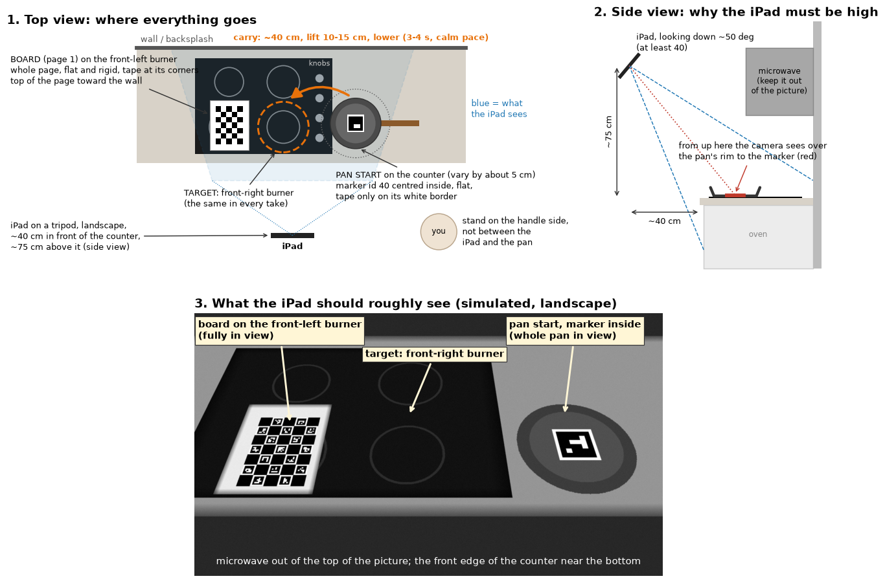

# Filming the phone clips

Goal: 15-20 short takes of a real frying pan being moved by its handle from the counter onto a
burner. Only the pan's motion is used (tracked from a printed marker); the robot does its own
grasp, and the stove knob is handled separately in simulation, so the stove needs no marker.



## Match LIBERO's layout

In LIBERO's kitchen, seen from where the robot stands, the **stove is on the robot's left** and
the **pan starts on its right**, about 45 cm away (measured in the simulator). LIBERO's videos are
saved as mirror images, so when you watch them it looks as if the pan were on the robot's left;
it is not.

Standing at the counter facing the wall, set up the same way:

- **Stove on your left, pan starting on the counter to your right** of the cooktop.
- **Target:** the front-right burner (the one next to the knobs), the same in every take,
  about 40-50 cm from the pan's start.

## Where each marker goes

Print `assets/markers_letter.pdf` at **100% / actual size** (US Letter) and check that the scale
bar measures 50 mm.

- **Board (page 1): on the front-left burner.** Keep the whole page (don't cut into the pattern),
  stuck to cardboard or another flat, stiff backing. Lay it flat with the top of the page toward
  the wall and tape it at the page corners, never over the squares. It never moves during the
  session. It is the fixed reference that everything is measured from, and it stays clear of the
  pan's path.
- **Pan marker (page 2, id 40, 80 mm): inside the pan, flat on the bottom, centred.** Cut along
  the grey line so the white border stays. Use double-sided tape underneath, or tape only on the
  white border; tape over the black squares makes glare. Which way it is rotated does not matter.
  The pan must be cold.
- **Nothing on the stove, the knobs or the handle.** Marker id 41 (40 mm) is only a spare.

## Scene

- Stove **off and cold** for the whole session. Never switch it on while paper is on it.
- Clear the cooktop and the path: salt, bottles, spatula and containers out of the way.
- Avoid bright reflections of the under-cabinet lights on the marker or the board. Try those
  lights on and off and keep whichever setting leaves no bright spot on them.

## Camera

- iPad or phone **fixed on a tripod**, in **landscape**, about 40 cm in front of the counter and
  about 75 cm above it (around eye level), **looking down about 50 degrees** (at least 40). From
  lower down, the pan's rim hides the marker.
- Frame: the board fully in view near the left edge, the whole pan at its start spot near the
  right edge (the end of the handle may be cut off), the microwave out of the picture.
- Stand on the handle side of the pan, not between the camera and the pan. Keep faces out of
  frame.
- 1x lens, 1080p at 60 fps (30 is fine). On iPad/iPhone set Settings > Camera > Formats > Most
  Compatible (H.264).
- Lock exposure and focus: tap and hold on the cooktop until "AE/AF LOCK" appears. Don't tap the
  screen again until you are done.

## Calibration clip (once, before the takes)

With the camera already in its final place and locked, record 20-30 s while **holding the
board** (by the white margins, fingers off the squares) about where the pan will be. Slowly tilt
it in different directions and move it into all four corners of the picture. Then lay it on the
front-left burner and tape it down. This clip measures the camera's lens; the camera itself must
not move afterwards.

## Check the setup (1 minute)

Record a 5-10 s test take, copy it to the computer and run:

```bash
python scripts/check_markers.py test.mov
```

It checks that the board and the pan marker are found in every frame and that the camera looks
down steeply enough, and saves annotated frames in `check_markers_out/`. Fix anything it flags
before recording the takes.

## The takes

1. Pan on its start spot; hold still for 2 s.
2. Pick it up by the handle; lift 10-15 cm, carry it over, lower it onto the burner, let go.
   Calm pace: about 3-4 s for the whole move, marker facing the camera.
3. Hold still for 2 s.
4. Put the pan back on the counter, shifting its start a few cm each time (within about 5 cm)
   and turning the handle a little.

One clip per take (`clip_01.mov`, `clip_02.mov`, ...) or one continuous recording of all the
takes both work: moves back to the counter are recognised and skipped.
