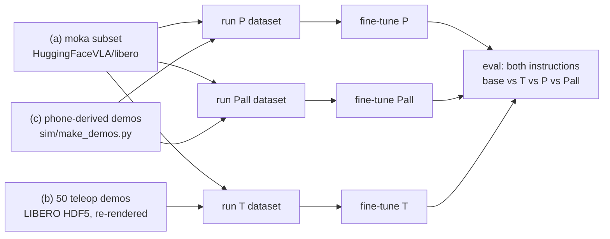

# Training and evaluation recipe

Three fine-tuning runs of [`smolvla_libero`](https://huggingface.co/HuggingFaceVLA/smolvla_libero),
identical except for where the frying-pan demos come from:

| Run | Frying-pan demos ("turn on the stove and put the **frying pan** on it") | Moka demos ("...put the **moka pot** on it") |
|---|---|---|
| **T** (teleop) | the 50 human teleop demos LIBERO ships for LIBERO-90 task 21 | all LIBERO-10 task 2 demos from the LeRobot LIBERO dataset |
| **P** (phone, same count) | as many phone-derived robot demos as T has teleop demos (`sim/make_demos.py`, round-robin over the takes) | the same moka demos |
| **Pall** (phone, all) | every phone-derived robot demo (153: 17 takes x 9 layouts) | the same moka demos |

P vs T asks whether phone-derived demos are as good as teleoperated ones at equal count; Pall vs P
asks what multiplying 6 minutes of video (18 clips) into more demos buys.

## Quick start: two machines

| | DGX Spark | RTX workstation |
|---|---|---|
| 1 | setup + checks (sections 0-1) | setup + checks (sections 0-1) |
| 2 | build datasets (section 2) | build datasets (section 2) |
| 3 | `bash train/train.sh Pall` | `bash train/train.sh T` |
| 4 | `bash train/eval.sh outputs/train/Pall/checkpoints/last/pretrained_model Pall` | `bash train/eval.sh outputs/train/T/checkpoints/last/pretrained_model T`, then `bash train/eval.sh HuggingFaceVLA/smolvla_libero base` |
| 5 | whichever is free first: `bash train/train.sh P`, then `bash train/eval.sh outputs/train/P/checkpoints/last/pretrained_model P` | |
| 6 | collect all `eval_logs/` on one machine: `python train/summarize_evals.py eval_logs --names base T P Pall --md eval_logs/summary.md` | |

The phone-derived datasets are built in the cloud session and arrive with the private clips repo:

```bash
CLIPS=../Humanoid_clips                # wherever the private clips repo is cloned
git -C $CLIPS pull                     # datasets/phone_pan_P (count-matched) and datasets/phone_pan_all
PHONE_DATASET=$CLIPS/datasets/phone_pan_P \
PHONE_ALL_DATASET=$CLIPS/datasets/phone_pan_all \
  bash train/build_datasets.sh
```

They were written with `fps = 10`, the same label as `HuggingFaceVLA/libero` (checked). That
dataset stores its camera frames as images inside the parquet files rather than as videos, so the
build script re-writes the phone datasets in moka's format by itself (`train/conform_dataset.py`;
it prints "re-writing ... in moka's format" and takes a few minutes for `phone_pan_all`).
If the DGX Spark (ARM) cannot run the LIBERO simulator, build the datasets on the RTX machine
(step (b) re-renders the teleop demos in LIBERO), copy `outputs/datasets/` to the Spark, train
there, and evaluate on the RTX machine: training only needs the datasets. Use the same `STEPS`
and `BATCH` for every run.

All three runs start from `HuggingFaceVLA/smolvla_libero`, use the same steps, batch size, seed, learning-rate
schedule and normalization statistics, and are evaluated, together with the untouched model, on
both instructions in the same kitchen (LIBERO-90 task 21 and LIBERO-10 task 2, all 50 start
layouts each).

Everything runs on the GPU machine (LeRobot 0.6.x, Hugging Face Hub access), from the repository
root. The scripts are in [`train/`](../train); nothing here needs to be edited.



## 0. Setup (once)

```bash
# SmolVLA, LIBERO and the training extras (accelerate), from PyPI or a LeRobot source checkout
pip install "lerobot[smolvla,libero,training]"     # or, in the checkout: pip install -e ".[smolvla,libero,training]"
export MUJOCO_GL=egl                          # headless GPU rendering
cd /path/to/humanoidai_challenge
python scripts/check_env.py                   # every line should say OK
```

`lerobot-train` refuses to start without `accelerate` (the `training` extra). Free disk needed:
about 15 GB: 3.1 GB of `HuggingFaceVLA/libero` files for the moka subset, the 1.4 GB teleop HDF5,
the datasets (images stored inside the parquet files make them several GB) and the checkpoints.

## 1. Checks that could not be done in the build container (5 min)

The scripts were written against the LeRobot 0.6.1 sources and tested end to end on stand-in
data (see the last section), but the build container had no Hub access. Run these first:

```bash
# 1. What smolvla_libero expects (keys, shapes) and its training preset
python - <<'EOF'
from lerobot.configs.policies import PreTrainedConfig
c = PreTrainedConfig.from_pretrained("HuggingFaceVLA/smolvla_libero")
print("inputs ", {k: tuple(v.shape) for k, v in c.input_features.items()})
print("outputs", {k: tuple(v.shape) for k, v in c.output_features.items()})
print(dict(chunk_size=c.chunk_size, n_action_steps=c.n_action_steps, num_steps=c.num_steps,
           lr=c.optimizer_lr, warmup=c.scheduler_warmup_steps, decay=c.scheduler_decay_steps,
           freeze_vision_encoder=c.freeze_vision_encoder, train_expert_only=c.train_expert_only))
EOF

# 2. The source dataset: fps, robot_type, feature names, and how many moka episodes it has
python train/make_moka_subset.py --dry-run

# 3. CLI flags used by the scripts still exist in 0.6.2
lerobot-train --help | grep -E -- "--(save_freq|log_freq|num_workers|rename_map)\b" | head
lerobot-edit-dataset --help | grep -E -- "concatenate_videos|roots" | head
```

What to expect, and what to do otherwise:

| Check | Expected | If not |
|---|---|---|
| policy inputs | `observation.images.image` and `observation.images.image2` (3x256x256), `observation.state` (8) | pass `--rename_map='{"<dataset key>": "<policy key>"}'` as an extra argument to `train/train.sh` after the tag (`bash train/train.sh P "" --rename_map='{...}'`; pass `""` when there is no tag) and to `train/eval.sh` after the name |
| policy output | `action` (7) | stop: the recipe assumes LIBERO's 7-D action |
| source `fps` | probably 10 (inherited from `physical-intelligence/libero`), maybe 20 | nothing: the converters copy the source's fps label automatically. One dataset frame is always one 20 Hz control step, and SmolVLA's action chunk is counted in frames, so the label does not change what is learned |
| source features | the four keys above plus LeRobot's index columns | an extra feature makes the merge refuse: drop it from the moka subset with `lerobot-edit-dataset --operation.type remove_feature` |
| moka episodes | up to 50; fewer is possible (the OpenVLA-regenerated LIBERO data that the LeRobot datasets derive from dropped demos that failed on replay) | if it finds **0**, run `python train/make_moka_subset.py --list-tasks` and pass the exact string with `--task` |
| codebase version | `v3.0` | a v2.x dataset must be converted first: `python -m lerobot.scripts.convert_dataset_v21_to_v30 --repo-id=...` |

To use `lerobot/libero` (or a per-suite dataset) instead: `SOURCE_REPO=lerobot/libero` for the
build script, or `--repo-id` for `make_moka_subset.py`. Episodes are selected by task string, so any
LeRobot v3 LIBERO dataset works.

## 2. Build the datasets (about 30 min)

```bash
PHONE_DEMOS=/path/to/make_demos_out bash train/build_datasets.sh
```

`PHONE_DEMOS` is one or more `sim/make_demos.py --out` folders (they contain `episodes/*.npz`). If
the phone demos are not ready yet, leave it out: the script builds the moka subset, the teleop
dataset and run T, and skips run P; run it again later with `PHONE_DEMOS` set (finished steps are
skipped; `REBUILD=1` redoes everything).

If the npz episodes live on another machine (they are ~35 MB each), convert them there and copy
only the LeRobot dataset (~2 MB per episode): `python train/convert_phone_npz.py MAKE_DEMOS_OUT
--fps <the source fps from step 1> --max-episodes 50 --out phone_pan`, then pass
`PHONE_DATASET=/path/to/phone_pan` instead of `PHONE_DEMOS`. The build script fixes the metadata
spelling against the moka subset; if the fps label or codec differs, it decodes the episodes and
writes them again in moka's format (`train/conform_dataset.py`).

| Step | Script | Output (`outputs/datasets/`) |
|---|---|---|
| (a) moka subset | `train/make_moka_subset.py` | `moka/`, `moka_subset.json`, `moka_preview.png` |
| (b) teleop demos | `train/convert_teleop_hdf5.py` | `teleop_pan/`, `teleop_pan_report.json`, `teleop_pan_episode0.mp4` |
| (c) phone demos | `train/convert_phone_npz.py` | `phone_pan/`, `phone_pan_report.json` |
| (c) ready-made phone datasets | copy + `train/check_datasets.py --harmonize`, else `train/conform_dataset.py` | `phone_pan/`, `phone_pan_all/` |
| check sources | `train/check_datasets.py` | `check_sources.png`, `check_sources.json` |
| (d) merge | `lerobot-edit-dataset --operation.type merge` | `P/` = moka + phone_pan, `Pall/` = moka + phone_pan_all, `T/` = moka + teleop_pan |
| pin stats | `train/pin_norm_stats.py` | `meta/stats.json` of each run (originals kept as `stats.dataset.json`) |
| check runs | `train/check_datasets.py` | `check_runs.png`, `check_runs.json` |

Logs go to `outputs/datasets/logs/`. **Look at these before training:**

1. `check_sources.png`: one row per dataset, frame 0 and a middle frame of the first episode, both
   cameras. All rows must have the same orientation (the robot arm at the top of the agentview
   image, the table and stove in front). If the moka row is rotated relative to ours, stop: the
   180-degree convention differs.
2. The end of `logs/check_sources.log` must say `ALL COMPATIBLE`. It also prints, per dataset,
   episode lengths and action statistics; differences between the phone and teleop rows (episode
   length, actions saturated at +-1, gripper-closed fraction) are worth a sentence in the write-up.
3. `logs/teleop_pan.log`: for each demo, whether the action replay succeeded (`actions`) or the
   recorded states were re-rendered (`states`), how far the stove had to be moved to where it was
   in the demo (`stove moved ... mm`, normally 0-20 mm), and the distance of its start layout to
   the nearest of the 50 eval layouts (pan and moka-pot positions, cm; 0.00 means it starts from
   an eval layout itself). If it warns `no model_file attribute`, the stove fix is off and more
   demos fall back to `states`.
4. `logs/pin_P.log`: the policy's and the dataset's state/action mean and std side by side.
   They should be of the same order (the policy's come from its own LIBERO training data).

Episode counts: `MATCH_COUNTS=1` (default) caps the phone episodes at the number of teleop
episodes, taking them round-robin over the takes, so P and T have the same number of frying-pan
episodes. If there are fewer phone episodes than teleop ones, either generate more layouts
(the README's `sim/make_demos.py ... --layouts 3 --speedup 1.5 --max-steps 400` with a new `--seed`) or cap the teleop demos with `TELEOP_ARGS="--demos 0-<N-1>"`.

**Teleop vs phone demos, side by side (2 min, optional but worth it for the README):**

```bash
python scripts/compare_demos.py --teleop outputs/datasets/teleop_pan \
    --phone outputs/datasets/phone_pan --out docs/img/teleop_vs_phone
```

It writes `docs/img/teleop_vs_phone.gif` (+ `.mp4`): one teleop demo and one phone-derived demo
playing side by side, both cameras as the model sees them; `teleop_vs_phone_paths.png`: every
demo's gripper path (top view and height over time), one column per dataset; and
`teleop_vs_phone.md`: a caption and a table (duration, time with the pan in hand, lift, speed,
smoothness of the commands). Alternatively push `outputs/datasets/teleop_pan` to the clips repo
(`datasets/teleop_pan`) and the comparison is made from there.

## 3. Train (2-4 h per run)

First a short timing run:

```bash
STEPS=200 SAVE_FREQ=200 bash train/train.sh P smoke
```

The log prints every 100 steps a line with `updt_s` (time per update) and `data_s` (time waiting
for data). Choose `STEPS` so that `STEPS x (updt_s + data_s)` fits the time you have (2-4 h), round
it to a multiple of `SAVE_FREQ`, and use **the same value for every run**. The default, 20 000
steps at batch 32 (about 25 passes over ~25k frames), takes about 2 h at 0.35 s/step. If
`data_s` is large, raise `NUM_WORKERS`; if the GPU runs out of memory, use `BATCH=16` and twice
the steps. Pall's dataset is about twice as large as P's or T's, so at the same number of steps
it sees each frame about half as often; mention this when comparing Pall with P. Then:

```bash
STEPS=20000 bash train/train.sh T      # -> outputs/train/T/checkpoints/{005000,...,last}/pretrained_model
STEPS=20000 bash train/train.sh P      # -> outputs/train/P/...
STEPS=20000 bash train/train.sh Pall   # -> outputs/train/Pall/...
```

With two GPUs they can run side by side: `CUDA_VISIBLE_DEVICES=0 bash train/train.sh P &` and
`CUDA_VISIBLE_DEVICES=1 bash train/train.sh T`. The untouched model can be evaluated (step 4) on
the same GPU while a run trains (SmolVLA inference needs a few GB).

What `train/train.sh` runs (P shown; T only changes `P` to `T`):

```bash
lerobot-train \
  --policy.path=HuggingFaceVLA/smolvla_libero --policy.push_to_hub=false --policy.device=cuda \
  --policy.n_action_steps=10 --policy.num_steps=10 \
  --dataset.repo_id=local/cooking_twin_P --dataset.root=outputs/datasets/P \
  --batch_size=32 --steps=20000 --save_freq=5000 --log_freq=100 --num_workers=8 --seed=1000 \
  --output_dir=outputs/train/P --job_name=cooking_twin_P --wandb.enable=false
```

| Setting | Value | Why |
|---|---|---|
| start | `HuggingFaceVLA/smolvla_libero` | the model under test; its own config (frozen vision encoder, action-expert training, optimizer preset) is kept |
| steps, batch | 20 000 x 32 (adjust after the timing run, same for every run) | ~25 epochs of a ~25k-frame dataset, in the range LeRobot's SmolVLA fine-tuning examples use |
| learning rate | the policy's preset (AdamW, cosine with warmup) | LeRobot shrinks warmup and decay to the run length when it is shorter than the preset's decay steps |
| normalization | smolvla_libero's own state/action mean and std, written into both datasets | see "Normalization" below |
| `n_action_steps`, `num_steps` | 10, 10 | only used at inference; stored in the checkpoint's config so that eval defaults match |
| seed | 1000 | same random draws for every run |
| checkpoints | every 5 000 steps + last | report `last` for every run; picking the best checkpoint on the test tasks would be tuning on the test set |

## 4. Evaluate (20-30 min per policy)

```bash
bash train/eval.sh HuggingFaceVLA/smolvla_libero base
bash train/eval.sh outputs/train/P/checkpoints/last/pretrained_model P
bash train/eval.sh outputs/train/T/checkpoints/last/pretrained_model T
bash train/eval.sh outputs/train/Pall/checkpoints/last/pretrained_model Pall
python train/summarize_evals.py eval_logs --names base T P Pall --md eval_logs/summary.md
```

Each call runs `scripts/eval_with_log.py` (= `lerobot-eval` plus the per-episode log) twice:

```bash
python scripts/eval_with_log.py --policy.path=<policy> \
  --policy.n_action_steps=10 --policy.num_steps=10 --policy.device=cuda \
  --env.type=libero --env.task=libero_90 --env.task_ids='[21]' \
  --eval.n_episodes=50 --eval.batch_size=1 --output_dir=eval_logs/<name>/pan
# and --env.task=libero_10 --env.task_ids='[2]' --output_dir=eval_logs/<name>/moka
```

50 episodes = each of the task's 50 fixed start layouts once. Outputs: `eval_logs/<name>/<pan|moka>/`
(`eval_info.json`, videos of the first 10 episodes), `eval_logs/<name>/<pan|moka>_episodes.jsonl`
(per episode: success, stove on, first object lifted, how far each object moved) and a log.
`summarize_evals.py` prints one table: success k/50 with a 95% interval, stove turned on, which
object was lifted first, and Fisher exact tests between policies on the same instruction.
With 50 episodes, the 95% interval is about +-14 points around 50%.

Render size: LeRobot's LIBERO env renders at its default (360x360 in LeRobot 0.6.1) unless told
otherwise, while all training images are 256x256 (SmolVLA resizes everything to 512 anyway).
`train/eval.sh` keeps the default, as the README's first results did. `EVAL_RES=256` renders at
the training size; whatever is chosen, use the same for every policy (the summary warns if not).

Reading the results: the frying-pan row tells whether the model now follows the word; the moka row
tells whether it kept the original task (fine-tuning on two tasks can trade one for the other);
"first object lifted" separates "went for the wrong object" from "fumbled the right one".

## 5. How the data is made

**Moka subset (a).** The episodes whose task string is "turn on the stove and put the moka pot on
it" are found in the source's `meta/episodes` (41 of them: the OpenVLA-regenerated data dropped
demos that failed on replay), only the files holding them are downloaded (35 files, 3.1 GB), and
LeRobot's own `split_dataset` writes them out (same features, fps, per-episode stats).
`HuggingFaceVLA/libero`'s `meta/episodes` points most episodes at the wrong data file (it was
written for 69 files; the data was later re-split into 377 files of ~100 MB without updating it),
so the script first reads the real files' row counts (parquet footers) and corrects the pointers
of the selected episodes in its local copy; otherwise LeRobot fetches the wrong files and fails
with `Instruction "train" corresponds to no data`.

**Teleop demos (b).** The LIBERO HDF5 (`yifengzhu-hf/LIBERO-datasets`, the same file
`scripts/replay_demo.py` uses) has 128x128 images, so every demo is re-rendered at 256x256:
- `--mode actions` follows OpenVLA's `regenerate_libero_dataset.py`, the recipe behind the
  OpenVLA LIBERO data that `HuggingFaceVLA/libero` derives from: load the demo's first MuJoCo state, 10 settle steps
  (as LeRobot's eval reset), re-send the human's actions, skip no-op actions, keep the demo if
  LIBERO's success check holds at the end.
- The stove is a LIBERO *fixture*: each env reset places it anew (about +-1 cm), and its pose is
  not in the MuJoCo state vector. The converter reads each demo's own stove pose from the demo's
  `model_file` XML and moves the stove there before replaying. In the build container, scripted
  demos recorded with one stove pose and replayed after a reset with another failed without
  this fix (stove off by 10 and 19 mm) and succeeded with it.
- `--mode auto` (default) falls back to re-rendering the recorded states (`states`: exactly the
  human's motion, recorded action, no-op frames dropped) for demos whose action replay fails, so
  all 50 human demos are kept. The report counts both kinds.
- Frames: agentview and wrist images rotated 180 degrees, state `[eef_pos, axis-angle, gripper
  qpos]` computed with LeRobot's own `LiberoProcessorStep` conversion (bit-identical to what
  `lerobot-eval` feeds the policy), action = the recorded 7-D action; frame t is the observation
  before action t.
- The report also gives, per demo, the distance of its start layout to the 50 eval layouts (the
  same pan + moka-pot measure `sim/make_demos.py` reports for its own layouts). If the human demos
  start from the eval layouts themselves (0.00 cm), T trains on the test layouts while P does not
  (`sim/make_demos.py` samples new ones): say so when comparing. The eval layouts are close
  together (a few cm apart), so only near-zero distances mean the same layout.

**Phone demos (c).** `sim/make_demos.py` already stores frames in the same conventions;
`train/convert_phone_npz.py` keeps kept, successful episodes not generated on eval layouts,
trims each to 10 frames after the first success (LIBERO's teleop demos also end right after
success, and an eval episode stops at it), recomputes the state from the raw robot state when the
npz has it, and writes them; `--max-episodes N` takes N episodes round-robin over the takes (this
is how `phone_pan_P` is capped to the teleop count). `sim/write_lerobot_dataset.py` is a second
writer with an extra reload check, but its defaults differ (keeps the frames after success, takes
the first N episodes); the datasets used for training are written with `train/convert_phone_npz.py`.

**Merging (d).** LeRobot only merges datasets with the same fps, robot_type and feature
definitions. Both converters therefore copy them from the moka subset (`--like`), encode the
videos with its codec, and afterwards rewrite our `meta/info.json` where only spelling differs
(feature names, legacy keys such as `video.is_depth_map`) after checking that size, fps and codec
really agree. The merge keeps one video file per source (`--operation.concatenate_videos false`),
which avoids stream concatenation between differently encoded files.

**Normalization.** When `lerobot-train` fine-tunes from a pretrained policy, it replaces the
policy's normalization statistics with the training dataset's `meta/stats.json`. T, P and Pall would
then normalize state and action differently from each other and from pretraining (scripted and
human demos can have quite different action statistics). `train/pin_norm_stats.py` writes smolvla_libero's
own state/action mean and std (read from its `policy_preprocessor` files) into every merged
dataset, so normalization is identical in all runs and equal to the pretrained model's.
`PIN_STATS=0` turns this off; `python train/pin_norm_stats.py --dataset outputs/datasets/P --restore`
undoes it.

## 6. Time budget

| Step | Estimate |
|---|---|
| checks (section 1) | 5 min |
| build datasets | 20-40 min (download, re-render 50 demos with EGL, encode) |
| timing run | 10 min |
| train P, train T | 2-4 h each (in sequence on one GPU) |
| eval base | 20-30 min (can run during training) |
| eval P, eval T | 20-30 min each |

Start the build first; evaluate the base model while P trains.

## 7. Troubleshooting

| Symptom | Fix |
|---|---|
| `ImportError: 'accelerate' is required` | `pip install -e ".[training]"` |
| merge: `Same fps/robot_type/features is expected` | run `python train/check_datasets.py outputs/datasets/moka outputs/datasets/<other>`: it lists the differing entries. Metadata-only differences: add `--harmonize`. A different fps or codec: `python train/conform_dataset.py <other> --like outputs/datasets/moka --out <new folder>` (or rebuild it with the converters' `--like`) |
| converter: `cannot encode with {'vcodec': ...}` | the source codec is missing from PyAV's FFmpeg; pass `--vcodec libsvtav1` (decoding still works per file) |
| teleop: `state dim ... != env state dim` | the HDF5 was recorded with a different LIBERO scene model than the installed `hf-libero`; neither mode can load its states. Check the `hf-libero` version against the one `lerobot[libero]` pins |
| `FileExistsError: Output directory ... already exists` | a training run with that name exists; delete it or give a tag: `bash train/train.sh P run2` |
| eval jsonl has more than 50 lines | an old log was appended to; `train/eval.sh` deletes it first, so rerun through `eval.sh` with `FORCE=1` |
| CUDA out of memory | `BATCH=16 STEPS=<2x>` (same for every run) |

## 8. What was tested in the build container, and what was not

Tested (LeRobot 0.6.1 / Python 3.12 replica with LIBERO, CPU, stand-in data): the moka subset on a
fake multi-task LIBERO dataset (fps 10, motor names, legacy info keys); the phone converter on
real `sim/make_demos.py` episodes; the teleop converter, in action-replay and state modes, on a
fake LIBERO-format HDF5 recorded with the scripted controller; harmonizing, merging with
`lerobot-edit-dataset`, pinning stats from a saved processor pipeline, loading the merged dataset
with SmolVLA's 50-step action chunks, three `lerobot-train` steps of a small policy on it (the
checkpoint carries the pinned stats), and the eval summary on synthetic logs. The 8-D state
conversion matches `LiberoProcessorStep` on float64 eval observations bit for bit.

Tested later with Hub access, on the real data: `make_moka_subset.py` on `HuggingFaceVLA/libero`
(a 2-episode subset; this found and fixed the wrong file pointers above), the teleop converter on
the real frying-pan HDF5, and `build_datasets.sh` end to end on that 2-episode moka subset, 2 real
teleop demos and small phone datasets (phone sets re-written in moka's image format, T/P/Pall
merged, stats pinned from the real `smolvla_libero`, merged sets loaded with 50-step action
chunks).

Not tested (no GPU): SmolVLA training itself (memory, speed); evaluation of fine-tuned checkpoints. Section 1 covers the
checks for these.
