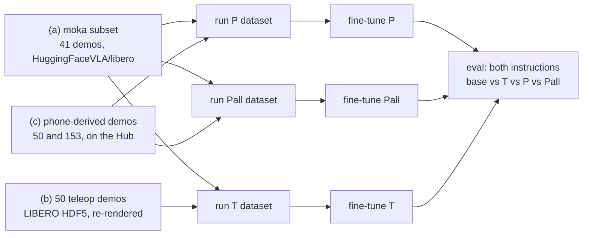

# Training and evaluation

I fine-tuned [`smolvla_libero`](https://huggingface.co/HuggingFaceVLA/smolvla_libero) three
times. The runs are identical except for where the frying-pan demos come from:

| Run | Frying-pan demos ("turn on the stove and put the **frying pan** on it") | Moka-pot demos ("...put the **moka pot** on it") | Episodes | Frames |
|---|---|---|---|---|
| **T** (teleop) | the 50 human teleop demos LIBERO ships for LIBERO-90 task 21 | the 41 LIBERO-10 task 2 demos in `HuggingFaceVLA/libero` | 91 | 24,801 |
| **P** (phone, same count) | 50 phone-derived robot demos, round-robin over the 17 usable takes | the same 41 | 91 | 24,677 |
| **Pall** (phone, all) | all 153 phone-derived demos (17 takes x 9 layouts) | the same 41 | 194 | 53,273 |

P vs T asks whether phone-derived demos are as good as teleoperated ones at equal count. Pall vs
P asks what multiplying 6 minutes of video (18 clips) into more demos buys.

All three runs start from `HuggingFaceVLA/smolvla_libero` and use the same steps (20,000), batch
size (32), seed (1000), learning-rate schedule and normalization statistics. At the same number of
steps, T and P see their data 25.8 and 25.9 times and Pall 12.0 times. The moka-pot demos are 45 %
of the episodes of T and P and 21 % of Pall's. Each fine-tune and the untouched model are then
evaluated on both instructions in the same kitchen (LIBERO-90 task 21 and LIBERO-10 task 2, all 50
test layouts of each).

## What was run

| Machine | Software | Used for |
|---|---|---|
| one Lambda Cloud instance: 2x H100 SXM5 80 GB, Ubuntu 22.04 | Python 3.12 (via uv), `lerobot[libero,smolvla,training]==0.6.1` from PyPI, `MUJOCO_GL=osmesa` | building the datasets, the three fine-tunes, uploading the models |
| my laptop: RTX 3050 4 GB, Ubuntu 24.04, Python 3.12.3 | LeRobot 0.6.2 built from source (commit `4aaff99b`), `MUJOCO_GL=egl` | evaluating the four models, the summary and the figures |

The phone pipeline (tracking and demo generation, [README, Reproduce (c)](../README.md#c-phone-demos-regenerate-mine-or-film-your-own)) ran before this, on
CPU, in a Python 3.11 venv with hf-libero 0.1.4, robosuite 1.4.0, MuJoCo 3.8.1 and OpenCV 5.0.
The LeRobot environment below also runs it: `lerobot[libero]` installs the same simulator
versions.

The steps, all from the repository root (the scripts are in [`train/`](../train); nothing needs
editing):

1. Cloud: setup and checks (section 0).
2. Cloud: build the datasets (section 1).
3. Cloud: a 200-step timing run, then T on GPU 0 and P and Pall together on GPU 1 (section 2).
4. Cloud: upload each model with its training log to the Hub. Laptop: download them (section 3).
5. Laptop: evaluate base, T, P and Pall on both instructions, summarize, copy into `results/`
   (section 4).



## 0. Setup (once per machine)

Ubuntu 22.04 ships Python 3.10. LeRobot 0.6.1, the newest LeRobot on PyPI, needs Python 3.12 or
newer. I used uv to get a separate Python 3.12 without touching the system one:

```bash
sudo apt-get update && sudo apt-get install -y build-essential cmake libosmesa6 libgl1 ffmpeg
#   compilers + cmake: one of LIBERO's packages builds from source; libosmesa6: MUJOCO_GL=osmesa
curl -LsSf https://astral.sh/uv/install.sh | sh && source $HOME/.local/bin/env
git clone https://github.com/pd05849/HumanoidAI_challenge.git && cd HumanoidAI_challenge
uv venv --python 3.12 && source .venv/bin/activate              # creates .venv/ here
uv pip install "lerobot[libero,smolvla,training]==0.6.1"
python -c "import libero.libero"       # first run asks for a dataset path: answer n
export MUJOCO_GL=egl                   # or osmesa, see below
python scripts/check_env.py            # every line should say OK
```

That one install brings everything the scripts use: SmolVLA, LIBERO and its simulator,
accelerate (`lerobot-train` refuses to start without the `training` extra), scipy, matplotlib,
h5py, PyAV and OpenCV with `cv2.aruco`.

- **`MUJOCO_GL`.** `egl` renders on the NVIDIA GPU. It needs NVIDIA's EGL vendor file
  (`/usr/share/glvnd/egl_vendor.d/10_nvidia.json`). The Lambda instance did not have it, so I used
  `osmesa` there: it renders on the CPU and needs `libosmesa6`. Training does not render. Only the
  dataset build does (the teleop re-render, step (b)). On the laptop `egl` worked.
- **LIBERO's first run** asks whether to set a custom dataset path. Answer `n`: the scripts download
  what they need themselves. If an old `~/.libero/config.yaml` points into a venv that no longer
  exists, imports fail; `rm -rf ~/.libero` and import again.

**Laptop (evaluation).** LeRobot 0.6.2 is not on PyPI (it has no release tag either). I
installed it from a source checkout of the LeRobot repository at commit `4aaff99b` (28 Aug 2026),
in a Python 3.12 venv made as above:

```bash
cd ~                                   # outside this repository
git clone https://github.com/huggingface/lerobot.git
git -C lerobot checkout 4aaff99b       # the commit I evaluated with
(cd lerobot && uv pip install -e ".[libero,smolvla,training]")
```

The results in `results/` come from 0.6.2. I did not evaluate with 0.6.1. Evaluation itself does
not need the `training` extra, but `check_env.py` reports accelerate as missing without it.

**Optional: what the policy and the source dataset look like.**

```bash
python - <<'EOF'
from lerobot.configs.policies import PreTrainedConfig
c = PreTrainedConfig.from_pretrained("HuggingFaceVLA/smolvla_libero")
print("inputs ", {k: tuple(v.shape) for k, v in c.input_features.items()})
print("outputs", {k: tuple(v.shape) for k, v in c.output_features.items()})
print(dict(chunk_size=c.chunk_size, n_action_steps=c.n_action_steps, num_steps=c.num_steps,
           lr=c.optimizer_lr, warmup=c.scheduler_warmup_steps, decay=c.scheduler_decay_steps,
           freeze_vision_encoder=c.freeze_vision_encoder, train_expert_only=c.train_expert_only))
EOF
python train/make_moka_subset.py --dry-run     # source fps, features, and the moka episodes it selects
```

| What | Value |
|---|---|
| policy inputs | `observation.images.image` and `observation.images.image2` (3x256x256), `observation.state` (8) |
| policy output | `action` (7), predicted in chunks of 50 |
| training preset kept by all runs | frozen vision encoder, action expert trained, AdamW at 1e-4, cosine decay with warmup |
| `HuggingFaceVLA/libero` | LeRobot v3.0, fps label 10, robot_type `panda`, camera images stored inside the parquet files |
| moka episodes in it | 41 (10,866 frames), not 50: the OpenVLA-regenerated LIBERO data it derives from dropped demos that failed on replay |

Episodes are selected by task string, so any LeRobot v3 LIBERO dataset works as the source:
`SOURCE_REPO=lerobot/libero` for the build script, or `--repo-id` for `make_moka_subset.py`. I
only used `HuggingFaceVLA/libero`.

## 1. Build the datasets (cloud)

The phone-derived datasets are public on Hugging Face, so the build downloads them by name:
[`Delcastillo8/libero90_frying_pan_phone_50`](https://huggingface.co/datasets/Delcastillo8/libero90_frying_pan_phone_50)
(the 50 demos of run P) and
[`Delcastillo8/libero90_frying_pan_phone`](https://huggingface.co/datasets/Delcastillo8/libero90_frying_pan_phone)
(all 153, run Pall). The command I ran:

```bash
export MUJOCO_GL=osmesa      # the script defaults to egl; use egl where it works
PHONE_DATASET=Delcastillo8/libero90_frying_pan_phone_50 \
PHONE_ALL_DATASET=Delcastillo8/libero90_frying_pan_phone \
  bash train/build_datasets.sh
```

Give both variables: they have no defaults. Without `PHONE_DATASET` there is no P, without
`PHONE_ALL_DATASET` no Pall (the script still builds the rest). Local folders work too, for
example the datasets written by step 4 of the README's phone pipeline:
`PHONE_DATASET=datasets/phone_pan_P PHONE_ALL_DATASET=datasets/phone_pan_all`. Steps whose output
already exists are skipped on a second call; `REBUILD=1` redoes everything.

The phone datasets were written with `fps = 10`, the same label as `HuggingFaceVLA/libero`. They
store the camera frames as video, while `HuggingFaceVLA/libero` stores them as images inside the
parquet files. LeRobot only merges datasets with the same features, so the build re-writes both
phone datasets in moka's format by itself (`train/conform_dataset.py`; it prints "metadata alone
cannot match moka: re-writing ... in moka's format").

What I got (`outputs/datasets/`):

| Dataset | Episodes | Frames |
|---|---|---|
| `moka` | 41 | 10,866 |
| `teleop_pan` | 50 (all 50 teleop demos kept) | 13,935 |
| `phone_pan` | 50 | 13,811 |
| `phone_pan_all` | 153 | 42,407 |
| `T` = moka + teleop_pan | 91 | 24,801 |
| `P` = moka + phone_pan | 91 | 24,677 |
| `Pall` = moka + phone_pan_all | 194 | 53,273 |

and `ALL COMPATIBLE` at the end of `logs/check_sources.log`.

**Teleop re-render in parallel.** Each of the 50 teleop demos is replayed in the simulator. The
script splits them over `TELEOP_JOBS` processes (default 4, about 2 GB of RAM each), then merges
the parts in demo order. Each part logs to `logs/teleop_pan.part<k>.log`; the per-demo records of
all parts go into one `teleop_pan_report.json`. `TELEOP_JOBS=1` runs a single process that logs to
`logs/teleop_pan.log`.

**Disk.** I did not measure the total; the cloud instance had far more than needed. The downloads
are 3.1 GB of `HuggingFaceVLA/libero` files (only the 35 data files that hold the moka episodes),
the 1.4 GB teleop HDF5 and the 1.2 GB `smolvla_libero` model. The build then writes the seven
datasets above, 183,770 frames in all, with both camera images inside the parquet files.
`HuggingFaceVLA/libero`, stored the same way, takes 0.13 MB per frame (34.9 GB for 273,465
frames), so expect over 20 GB for them. Each checkpoint holds a 1.2 GB model plus the optimizer
state, and each run saves four. Plan for at least 50 GB free.

| Step | Script | Output (`outputs/datasets/`) |
|---|---|---|
| (a) moka subset | `train/make_moka_subset.py` | `moka/`, `moka_subset.json`, `moka_preview.png` |
| (b) teleop demos | `train/convert_teleop_hdf5.py`, in `TELEOP_JOBS` parts | `teleop_pan/`, `teleop_pan_report.json`, `teleop_pan_episode0.mp4` |
| (c) phone datasets | download, then `train/check_datasets.py --harmonize`, else `train/conform_dataset.py` | `phone_pan/`, `phone_pan_all/` (Hub copies in `hub/`) |
| check sources | `train/check_datasets.py` | `check_sources.png`, `check_sources.json` |
| (d) merge | `lerobot-edit-dataset --operation.type merge` | `T/` = moka + teleop_pan, `P/` = moka + phone_pan, `Pall/` = moka + phone_pan_all |
| pin stats | `train/pin_norm_stats.py` | `meta/stats.json` of each run (originals kept as `stats.dataset.json`) |
| check runs | `train/check_datasets.py` | `check_runs.png`, `check_runs.json` |

Logs go to `outputs/datasets/logs/`. **Look at these before training:**

1. `check_sources.png`: one row per dataset, frame 0 and a middle frame of the first episode, both
   cameras. All rows must have the same orientation (the robot arm at the top of the agentview
   image, the table and stove in front). A rotated row means a different 180-degree convention.
2. The end of `logs/check_sources.log` must say `ALL COMPATIBLE`. It also prints, per dataset,
   episode lengths and action statistics (actions saturated at +-1, gripper-closed fraction).
3. `logs/teleop_pan.part*.log`: one line per demo. It says whether the action replay succeeded
   (`actions`) or the recorded states were re-rendered (`states`), how far the stove had to be
   moved to where it was in the demo (`stove moved ... mm`), and the distance of its start layout
   to the nearest of the 50 test layouts (pan and moka-pot positions, cm). If it warns
   `no model_file attribute`, the stove fix is off and more demos fall back to `states`.
4. `logs/pin_T.log` (and `pin_P.log`, `pin_Pall.log`): the policy's and the dataset's state/action
   mean and std side by side. They should be of the same order (the policy's come from its own
   LIBERO training data).

**Alternative: phone demos from npz episodes.** Instead of a ready-made dataset, `PHONE_DEMOS`
takes one or more `sim/make_demos.py --out` folders (they contain `episodes/*.npz`, about 35 MB
each), for example `PHONE_DEMOS="demos/r0 demos/r1 demos/r2"`. The script then converts them itself
with `train/convert_phone_npz.py`. With `MATCH_COUNTS=1` (default) it keeps as many phone episodes
as there are teleop episodes, taken round-robin over the takes, so P and T get the same number of
frying-pan episodes. `PHONE_DEMOS` wins over `PHONE_DATASET` if both are set, and it does not make
Pall: that still needs `PHONE_ALL_DATASET`. I did not use this path for the results.

## 2. Train (cloud, about 4 h per run)

First a short timing run:

```bash
STEPS=200 SAVE_FREQ=200 bash train/train.sh P smoke      # -> outputs/train/P_smoke
```

Every 100 steps the log prints `updt_s` (time per update) and `data_s` (time waiting for data).
In my trial they were 0.20 s and 0.58 s per step: data loading was the bottleneck, not the GPU.
SmolVLA learns 50-step action chunks, so each training sample needs the actions of the next 50
frames. LeRobot 0.6.1 gets them by reading those 50 dataset rows, and when the camera images are
stored inside the rows, as here, it decodes both images of all 50 rows, although only the first
frame's images go into the model. At batch 32 that is about 3,200 image decodes per step. The
images are stored that way because `HuggingFaceVLA/libero` stores them that way, and LeRobot only
merges datasets with the same features.

So for the real runs I raised the data workers from the default 8 to 12, and ran T alone on GPU 0
and P and Pall together on GPU 1. Run each in its own `tmux` window (or with `nohup`), so that a
dropped SSH session does not stop it:

```bash
NUM_WORKERS=12 CUDA_VISIBLE_DEVICES=0 bash train/train.sh T      # -> outputs/train/T, log outputs/train/T.log
NUM_WORKERS=12 CUDA_VISIBLE_DEVICES=1 bash train/train.sh P      # -> outputs/train/P
NUM_WORKERS=12 CUDA_VISIBLE_DEVICES=1 bash train/train.sh Pall   # -> outputs/train/Pall
```

They took 4.0 h (T), 3.9 h (P) and 3.7 h (Pall), about 0.7 s per step. Sharing a GPU did not
slow P and Pall down. Each run saves a checkpoint every 5,000 steps,
`outputs/train/<RUN>/checkpoints/{005000,010000,015000,020000,last}/pretrained_model`; I report
`last`. At exit, after the last checkpoint, the log may end with
`DataLoader worker (pid ...) is killed by signal: Aborted` and
`terminate called without an active exception`. Both are harmless: the checkpoint is already
written.

What `train/train.sh` runs (T shown, with `NUM_WORKERS=12`):

```bash
lerobot-train \
  --policy.path=HuggingFaceVLA/smolvla_libero --policy.push_to_hub=false --policy.device=cuda \
  --policy.n_action_steps=10 --policy.num_steps=10 \
  --dataset.repo_id=local/cooking_twin_T --dataset.root=outputs/datasets/T \
  --batch_size=32 --steps=20000 --save_freq=5000 --log_freq=100 --num_workers=12 --seed=1000 \
  --output_dir=outputs/train/T --job_name=cooking_twin_T --wandb.enable=false
```

| Setting | Value | Why |
|---|---|---|
| start | `HuggingFaceVLA/smolvla_libero` | the model under test; its own config (frozen vision encoder, action-expert training, optimizer preset) is kept |
| steps, batch | 20,000 x 32, the same for every run | 25.8 / 25.9 / 12.0 passes over the data of T / P / Pall; in the range LeRobot's SmolVLA fine-tuning examples use |
| learning rate | the policy's preset (AdamW, 1e-4, cosine decay with warmup) | LeRobot shrinks warmup and decay to the run length when it is shorter than the preset's 30,000 decay steps |
| normalization | smolvla_libero's own state/action mean and std, written into every merged dataset | see "Normalization" in section 5 |
| data workers | 12 (`NUM_WORKERS`; the script's default is 8) | data loading sets the pace |
| `n_action_steps`, `num_steps` | 10, 10 | only used at inference; stored in the checkpoint's config so that eval defaults match |
| seed | 1000 | same random draws for every run |
| checkpoints | every 5,000 steps + last | report `last` for every run; picking the best checkpoint on the test tasks would be tuning on the test set |

**Training loss.** `train/train.sh` keeps the whole lerobot-train log in `outputs/train/<RUN>.log`;
each published model carries it as `train.log`. One figure, table and CSV for all three runs
(the names default to T, P, Pall for three logs):

```bash
python scripts/plot_loss.py outputs/models/T/train.log outputs/models/P/train.log \
    outputs/models/Pall/train.log --out docs/img/train_loss
```

It writes [`docs/img/train_loss.png`](img/train_loss.png), `.csv` and
[`.md`](img/train_loss.md). Final loss (mean of the last 1,000 steps): P 0.058, T 0.075, Pall
0.080. The loss shows that training converged. It does not rank the runs: each run's loss is
measured on its own training data, so only the evaluation compares them.

## 3. Models on the Hugging Face Hub

I uploaded each `last` checkpoint as a model repository, with its training log and the dataset
build logs:

```bash
hf auth login                          # once, with a token that can write
HF_USER=your-hf-name
for RUN in T P Pall; do
  REPO=$HF_USER/smolvla_libero_frying_pan_$RUN
  hf upload $REPO outputs/train/$RUN/checkpoints/last/pretrained_model . --private
  hf upload $REPO outputs/train/$RUN.log train.log
  hf upload $REPO outputs/datasets/logs dataset_build
done
```

The three models:

| Run | Model |
|---|---|
| T | [`Delcastillo8/smolvla_libero_frying_pan_T`](https://huggingface.co/Delcastillo8/smolvla_libero_frying_pan_T) |
| P | [`Delcastillo8/smolvla_libero_frying_pan_P`](https://huggingface.co/Delcastillo8/smolvla_libero_frying_pan_P) |
| Pall | [`Delcastillo8/smolvla_libero_frying_pan_Pall`](https://huggingface.co/Delcastillo8/smolvla_libero_frying_pan_Pall) |

On the evaluation machine, download them **inside the repository folder**:

```bash
cd HumanoidAI_challenge
for RUN in T P Pall; do
  hf download Delcastillo8/smolvla_libero_frying_pan_$RUN --local-dir outputs/models/$RUN
done
```

`train/eval.sh` changes to the repository root before it runs, so a relative path is read from
there. If `outputs/models/T` does not exist there, LeRobot takes the path for a Hub repo id and
fails with `Repo id must be in the form 'repo_name' or 'namespace/repo_name'`. Passing the Hub id
to `train/eval.sh` also works and skips the download step.

## 4. Evaluate (laptop)

```bash
export MUJOCO_GL=egl
bash train/eval.sh HuggingFaceVLA/smolvla_libero base
bash train/eval.sh outputs/models/T T          # or Delcastillo8/smolvla_libero_frying_pan_T
bash train/eval.sh outputs/models/P P
bash train/eval.sh outputs/models/Pall Pall
python train/summarize_evals.py eval_logs --names base T P Pall --md eval_logs/summary.md
```

Each call runs `scripts/eval_with_log.py` (= `lerobot-eval` plus a per-try log) twice:

```bash
python scripts/eval_with_log.py --policy.path=<policy> \
  --policy.n_action_steps=10 --policy.num_steps=10 --policy.device=cuda \
  --env.type=libero --env.task=libero_90 --env.task_ids='[21]' \
  --eval.n_episodes=50 --eval.batch_size=1 --output_dir=eval_logs/<name>/pan
# and --env.task=libero_10 --env.task_ids='[2]' --output_dir=eval_logs/<name>/moka
```

Keep `--policy.n_action_steps=10`: with `n_action_steps=50` (SmolVLA's default: run the whole
50-step action chunk before looking again) the model scored 0 even on the task it was trained on.
`train/eval.sh` always passes 10. The step limits are LIBERO's: 400 for the frying pan, 520 for
the moka pot. SmolVLA inference with batch 1 fits on the laptop's 4 GB GPU.

50 tries = each of the task's 50 fixed test layouts once. Outputs:

- `eval_logs/<name>/<pan|moka>/`: `eval_info.json` and the videos. `lerobot-eval` keeps videos of
  the first 10 tries only.
- `eval_logs/<name>/<pan|moka>_episodes.jsonl`: per try, success, when the stove was turned on,
  which object was lifted first, and how far each object moved and was lifted.
- `eval_logs/<name>/<pan|moka>.log`, and `<pan|moka>.meta.json` (policy, task, number of tries,
  render size), written only when the task's run has finished.

**Skip and redo.** `train/eval.sh` skips a task whose `.meta.json` exists. A task without one, for
example after an interrupted run, is redone from scratch (its folder and jsonl are deleted first).
`ONLY=pan` or `ONLY=moka` runs one task; `FORCE=1` redoes it even if it finished:

```bash
ONLY=moka FORCE=1 bash train/eval.sh outputs/models/T T
```

`summarize_evals.py` prints one table: success k/50 with a 95 % Wilson interval, stove turned on,
which object was lifted first, and two-sided Fisher exact tests between policies on the same
instruction. With 50 tries the 95 % interval is about +-13 points around 50 %. It warns about a
task without a `.meta.json` (an unfinished run) and about policies evaluated at different render
sizes.

**Into the repository.** The per-try logs and the summary go into `results/` (videos stay out),
where `scripts/analyze_results.py` reads them, together with `results/start_layouts.csv`:

```bash
for r in base T P Pall; do
  mkdir -p results/$r
  cp eval_logs/$r/{pan,moka}_episodes.jsonl eval_logs/$r/{pan,moka}.meta.json results/$r/
done
cp eval_logs/summary.md results/summary.md
python scripts/analyze_results.py      # the numbers behind README section 4
```

The rollout GIF at the top of the README comes from the saved videos:
`python scripts/make_rollout_gif.py base:pan:6 Pall:pan:2 Pall:moka:0 --out docs/img/rollouts.gif`.

**Render size.** LeRobot's LIBERO env renders at its default size (360x360 in LeRobot 0.6.1)
unless told otherwise, while all training images are 256x256 (SmolVLA resizes everything to 512
anyway). `train/eval.sh` keeps the default, and so do all results in `results/` (`eval_res`
"default" in each `.meta.json`). `EVAL_RES=256` renders at the training size; whatever you choose,
use the same for every policy.

**Reading the results.** The frying-pan row tells whether the model now follows the word. The moka
row tells whether it kept the original task (fine-tuning on two tasks can trade one for the
other). "First object lifted" separates "went for the wrong object" from "fumbled the right one".

## 5. How the data is made

**Moka subset (a).** The episodes whose task string is "turn on the stove and put the moka pot on
it" are found in the source's `meta/episodes`: 41 of them (the OpenVLA-regenerated data dropped
demos that failed on replay). Only the files holding them are downloaded (35 files, 3.1 GB), and
LeRobot's own `split_dataset` writes them out (same features, fps, per-episode stats).
`HuggingFaceVLA/libero`'s `meta/episodes` points most episodes at the wrong data file: it was
written for 69 files, and the data was later re-split into 377 files of about 100 MB without
updating it. So the script first reads the real files' row counts (parquet footers) and corrects
the pointers of the selected episodes in its local copy. Otherwise LeRobot fetches the wrong files
and fails with `Instruction "train" corresponds to no data`.

**Teleop demos (b).** The LIBERO HDF5 (`yifengzhu-hf/LIBERO-datasets`, the same file
`scripts/replay_demo.py` uses) has 128x128 images, so every demo is re-rendered at 256x256:
- `--mode actions` follows OpenVLA's `regenerate_libero_dataset.py`, the recipe behind the
  OpenVLA LIBERO data that `HuggingFaceVLA/libero` derives from: load the demo's first MuJoCo
  state, 10 settle steps (as LeRobot's eval reset), re-send the human's actions, skip no-op
  actions, keep the demo if LIBERO's success check holds at the end.
- The stove is a LIBERO *fixture*: each env reset places it anew (about +-1 cm), and its pose is
  not in the MuJoCo state vector. The converter reads each demo's own stove pose from the demo's
  `model_file` XML and moves the stove there before replaying. In a test with scripted demos
  recorded with one stove pose and replayed after a reset with another, the replays failed
  without this fix (stove off by 10 and 19 mm) and succeeded with it.
- `--mode auto` (default) falls back to re-rendering the recorded states (`states`: exactly the
  human's motion, recorded action, no-op frames dropped) for demos whose action replay fails, so
  all 50 human demos are kept. The report counts both kinds.
- Frames: agentview and wrist images rotated 180 degrees, state `[eef_pos, axis-angle, gripper
  qpos]` computed with LeRobot's own `LiberoProcessorStep` conversion (bit-identical to what
  `lerobot-eval` feeds the policy), action = the recorded 7-D action; frame t is the observation
  before action t. One dataset frame is one 20 Hz control step, whatever the fps label says, and
  SmolVLA's action chunk is counted in frames, so the label does not change what is learned.
- The report also gives, per demo, the distance of its start layout to the 50 test layouts (the
  same pan + moka-pot measure `sim/make_demos.py` reports for its own layouts). For LIBERO's 50
  human demos the nearest test layout is 0.5-2.1 cm away, for the phone demos 0.3-2.5 cm: neither
  training set starts from the test layouts.

**Phone demos (c).** `sim/make_demos.py` already stores frames in the same conventions.
`train/convert_phone_npz.py` keeps kept, successful episodes not generated on test layouts, trims
each to 10 frames after the first success (LIBERO's teleop demos also end right after success, and
an eval episode stops at it), recomputes the state from the raw robot state when the npz has it,
and writes them. `--max-episodes N` takes N episodes round-robin over the takes; that is how
`phone_pan_P` has 50. `sim/write_lerobot_dataset.py` is a second writer with an extra reload check,
but its defaults differ (it keeps the frames after success and takes the first N episodes); the
datasets used for training were written with `train/convert_phone_npz.py`.

**Merging (d).** LeRobot only merges datasets with the same fps, robot_type and feature
definitions. The converters therefore copy them from the moka subset (`--like`), so their images
are stored inside the parquet files as in moka. Afterwards the build rewrites our
`meta/info.json` where only spelling differs (feature names, legacy keys such as
`video.is_depth_map`), after checking that sizes, fps and codec really agree. A dataset that
differs in more than spelling, such as the video-based phone datasets from the Hub, is decoded and
written again in moka's format (`train/conform_dataset.py`; frames are not resampled). The merge
keeps one video file per source (`--operation.concatenate_videos false`), which avoids stream
concatenation between differently encoded files.

**Normalization.** When `lerobot-train` fine-tunes from a pretrained policy, it replaces the
policy's normalization statistics with the training dataset's `meta/stats.json`. T, P and Pall
would then normalize state and action differently from each other and from pretraining (scripted
and human demos can have quite different action statistics). `train/pin_norm_stats.py` writes
smolvla_libero's own state/action mean and std (read from its `policy_preprocessor` files) into
every merged dataset, so normalization is identical in all runs and equal to the pretrained
model's. `PIN_STATS=0` turns this off; `python train/pin_norm_stats.py --dataset outputs/datasets/P
--restore` undoes it.

## 6. Time budget

Measured on the machines above. Steps I did not time are marked.

| Step | Machine | Time |
|---|---|---|
| setup (section 0) | cloud | not timed |
| build the datasets (section 1) | cloud, `MUJOCO_GL=osmesa`, `TELEOP_JOBS=4` | not timed |
| 200-step timing run | cloud, 1 H100 | 0.78 s per step (`updt_s` 0.20 s + `data_s` 0.58 s) |
| train T | cloud, GPU 0 alone | 4.0 h (20,000 steps) |
| train P | cloud, GPU 1, shared with Pall | 3.9 h |
| train Pall | cloud, GPU 1, shared with P | 3.7 h |
| evaluate one policy (2 x 50 tries) | laptop, RTX 3050 4 GB | not timed |

The training times come from the logs (`plot_loss.py` prints them in its table).

## 7. Troubleshooting

| Symptom | Cause and fix |
|---|---|
| `pip` / `uv pip` finds no `lerobot==0.6.1` | Python 3.10 (Ubuntu 22.04's default). LeRobot 0.6.1 needs Python >= 3.12: make the venv with `uv venv --python 3.12` (section 0). Without the version pin, pip on Python 3.10 installs LeRobot 0.4.4, which these scripts were not written for |
| no `lerobot==0.6.2` on PyPI | 0.6.1 is the newest release there. Use 0.6.1 for the datasets and training (as I did), or install a LeRobot source checkout (as I did for evaluation) |
| `check_env.py` says `MISSING` for "LIBERO-90 task 21 renders" with `MUJOCO_GL=egl` | NVIDIA's EGL vendor file is missing (`/usr/share/glvnd/egl_vendor.d/10_nvidia.json`). `sudo apt-get install -y libosmesa6`, `export MUJOCO_GL=osmesa`. Training does not render; only the dataset build's teleop re-render does, then on the CPU |
| `import libero.libero` fails with paths into a venv that no longer exists | a stale `~/.libero/config.yaml` from an earlier install. `rm -rf ~/.libero`, import again, answer `n` |
| `ImportError: 'accelerate' is required` | the `training` extra is missing: `uv pip install "lerobot[libero,smolvla,training]==0.6.1"` |
| `Repo id must be in the form 'repo_name' or 'namespace/repo_name'` | the local model folder does not exist where `train/eval.sh` looks (the repository root), so LeRobot took the path for a Hub id. Run `hf download ... --local-dir outputs/models/<RUN>` inside the repository folder, or pass the Hub id |
| end of a training log: `DataLoader worker (pid ...) is killed by signal: Aborted`, `terminate called without an active exception` | harmless; they come after the last checkpoint. Check that `outputs/train/<RUN>/checkpoints/last/pretrained_model` exists |
| an evaluation stopped halfway (Ctrl-C, sleep, crash) | run the same `train/eval.sh` command again: finished tasks (with a `.meta.json`) are skipped, the unfinished one starts over. `summarize_evals.py` flags a task without a `.meta.json` |
| merge refuses (different fps, robot_type or features) | `python train/check_datasets.py outputs/datasets/moka outputs/datasets/<other>` lists the differing entries. Metadata-only differences: add `--harmonize`. A different fps, codec or image storage: `python train/conform_dataset.py <other> --like outputs/datasets/moka --out <new folder>` |
| teleop: `state dim ... != env state dim` | the HDF5 was recorded with a different LIBERO scene model than the installed `hf-libero`; neither mode can load its states. Check the `hf-libero` version against the one `lerobot[libero]` pins |
| `FileExistsError: Output directory ... already exists` | a training run with that name exists; delete it or give a tag: `bash train/train.sh P run2` |
| CUDA out of memory in training | `BATCH=16 STEPS=40000`, the same for every run |
